# Organization recovery by a quorum of custodians (Shamir)

Status: **decided, first version built** (2026-10-28, branch `shamir-recovery`). This document proposes a third recovery route, between the user's own Kit and trusted contacts: a designated group of people in the user's organization (security officers, DPO, IT management) who can, **together and immediately**, give a locked-out user their vault back, without any one of them being able to do it alone. It keeps every option that was considered, so the choice can be presented and revisited; [§0](#built) says what was built, and the sections below mark each alternative as built, considered or rejected.

## Contents

0. [What was built](#built)
1. [Why a third route](#why)
2. [Naming](#naming)
3. [Working decisions so far](#decisions)
4. [Configuration](#config)
5. [Common building block: split the emergency phrase](#split)
6. [Proposals P1 to P4](#proposals)
7. [Recommended flow: remote approvals, last share in person](#flow)
8. [Who is a custodian, and what each client learns](#visibility)
9. [How the user trusts the council](#roster)
10. [Governance: the configuration proposes, the custodians decide](#governance)
11. [Lifecycle](#lifecycle)
12. [Multi-factor authentication for custodians](#mfa)
13. [Threat model](#threats)
14. [Implementation notes](#impl)
15. [Open questions](#open)

<a id="built"></a>

## 0. What was built

| Topic                   | Built                                                                                                                                                                                                                                                                 | Considered, kept below                                                                                                                            |
| ----------------------- | --------------------------------------------------------------------------------------------------------------------------------------------------------------------------------------------------------------------------------------------------------------------- | ------------------------------------------------------------------------------------------------------------------------------------------------- |
| What is split           | a per-user dormant emergency phrase `E` ([§5](#split)), **verifiable** Shamir (Pedersen commitments over ristretto255, libsodium primitives only, `src/crypto/shamir.ts`, [§5.2](#vss))                                                                               | the VRK, a council-wide key ([P4](#p4)), the 24 words themselves, plain Shamir over GF(2^8) (first version), Feldman commitments                  |
| Where shares meet       | only in the locked-out user's browser ([P3](#p3))                                                                                                                                                                                                                     | a custodian combines ([P2](#p2)), dictated shares ([P3-bis](#p3bis)), approvals without Shamir ([P1](#p1))                                        |
| Recovery flow           | `k - 1` remote approvals at most, the last share in person against the 40-digit code (or QR) of the browser's ephemeral key ([§7](#flow)); the user sees "in progress", then "go and see one of these people"                                                         | real-time updates (not needed)                                                                                                                    |
| Configuration           | `RECOVERY_COUNCILS`, same shape and matching code as `MAINTENANCE_ESCROW_KEYS` ([§4](#config)); **2 to 12 custodians, `1 <= k <= n - 1`** (warnings at boot for `k = 1` and a margin of 1)                                                                            | a percentage threshold, one `ORGANIZATIONS` variable, per-council MFA policy                                                                      |
| Authority on membership | a chain of roster versions signed by custodians ([§9](#roster), [§10](#governance)); **version 1 signed by every member**, later ones by a **majority of the previous (never fewer than `k`)** plus every newcomer; a broken or empty variable deletes nothing        | first version active from `k + 1` acceptances, an organization signing key, a transparency log                                                    |
| Membership changes      | **the council moves escrows itself**: resharing in batches from `k` custodians' vaults, no user involved ([§11.2](#reshare))                                                                                                                                          | silent re-arm by each user's vault ([§11.1](#rearm)), adding a point for a newcomer ([§11.7](#enroll)), handing over a share ([§11.3](#handover)) |
| User re-arm             | only (1) the forced phrase change after a council recovery, and (2) an **explicit** "set up again" when too few custodians can still open the escrow, judged from the signed head, never from the configuration                                                       | automatic re-arm on every new version                                                                                                             |
| Who decides             | every decision is a click in the interface, a privileged vault operation ([§10.1](#manual)); custodian routes require the step-up ([§12](#mfa))                                                                                                                       |                                                                                                                                                   |
| Visibility              | `/api/councils/mine` says only "custodian" or "invited"; users covered by a council see its members' names ([§8](#visibility))                                                                                                                                        |                                                                                                                                                   |
| Screens (with stories)  | `RecoveryCouncil` (accept, state, set up again), `CouncilRecovery` (locked-out user), `CouncilCustodian` (one card per council, inbox, health, resharing), `CouncilSignChange`, `CouncilHandOver`; entry points in the settings home and in "Restore your encryption" | an email to the users a new council covers ([§11.6](#late-council)), a badge in each product (dropped)                                            |

<a id="why"></a>

## 1. Why a third route

Three mechanisms exist, and none covers "one person, locked out, today":

| Route                                                                             | Who can act                                                       | Delay                   | Weakness for this case                                                                                                                                                                                                                                                                                                                                                                                                                                 |
| --------------------------------------------------------------------------------- | ----------------------------------------------------------------- | ----------------------- | ------------------------------------------------------------------------------------------------------------------------------------------------------------------------------------------------------------------------------------------------------------------------------------------------------------------------------------------------------------------------------------------------------------------------------------------------------ |
| **Recovery Kit** ([architecture.md §7.2](architecture.md#s7-2))                   | The user                                                          | None                    | Lost with the device and the paper, which is exactly the case to cover.                                                                                                                                                                                                                                                                                                                                                                                |
| **Trusted contact** ([architecture.md §8](architecture.md#s8))                    | One chosen colleague                                              | 1 to 90 days, by design | The colleague can leave the organization, lose their own keys, or be unreachable. The wait is the whole protection, so it cannot be shortened, and a week without one's documents is not acceptable for some roles.                                                                                                                                                                                                                                    |
| **Maintenance escrow** ([architecture.md Appendix E](architecture.md#appendix-e)) | An organization's custodians, with its offline maintenance phrase | None                    | Built for a **massive** loss: a technical failure on our side (a broken encryption in a product, a support rollback), where many users must be recovered at once. It is temporary by design, and it opens **resource keys** in batch with an offline tool, never a vault. It cannot restore a person's identity, contacts or ability to keep working; using it for one person means taking out the phrase that opens the whole organization's content. |

The two are complementary rather than competing: the maintenance escrow answers "we broke something for everyone", the council answers "this person is locked out". Appendix E already points to a recovery council for the single-user case. They share their configuration shape and its code ([§4.1](#config-shared)), and probably their people ([question 8](#open)).

The new route keeps the structure of trusted contacts (a dormant second credential of the same vault, [architecture.md §8.1](architecture.md#s8-1)) and changes two things: the escrow is **split** between several people instead of given to one, and the protection is **human verification by a quorum** instead of a wait.

[architecture.md §8](architecture.md#s8) lists M-of-N recovery under "Alternatives set aside" for trusted contacts, on the ground that one well-chosen contact behind a delay is enough, and notes that shares could be added later. This document is that later case: the motivation (a contact who leaves, a delay that is not acceptable) is precisely what the set-aside reasoning did not cover.

<a id="naming"></a>

## 2. Naming

The role needs a name that says "mandated by the organization", "can only act together", and not "administrator" (they administer nothing and see nothing).

| English                   | French                           | Comment                                                                                                                                                                       |
| ------------------------- | -------------------------------- | ----------------------------------------------------------------------------------------------------------------------------------------------------------------------------- |
| **Recovery custodians**   | **Dépositaires de recouvrement** | Recommended. A custodian holds something in trust for someone else, which is literally what a share is. "Dépositaire" has the same legal meaning in French.                   |
| Recovery council / quorum | Collège de recouvrement          | Recommended for the **group**: "le collège de recouvrement de la DINUM, 2 dépositaires sur 4". "Collège" already means a body that decides together in French administration. |
| Recovery officers         | Délégués au recouvrement         | Sounds like a job title, which is fine for a RSSI but suggests individual power.                                                                                              |
| Key recovery agents       | Agents de recouvrement de clés   | The PKI term (Windows AD CS "KRA"). Precise, but evokes a single agent with a master key.                                                                                     |
| Mandated recoverers       | Mandataires de recouvrement      | Close to "personnes mandatées", a bit heavy.                                                                                                                                  |

The rest of this document uses **council** for the group, **custodian** for a member, **threshold** (`k`) for the number of shares required, `n` for the number of custodians, **margin** for `n - k`, and **share** for a custodian's piece.

<a id="decisions"></a>

## 3. Working decisions so far

Not final, but the discussion converged on these, and the rest of the document builds on them:

1. **Split a per-user emergency phrase `E`**, never the VRK and never a council-wide key ([§5](#split), [P4](#p4)).
2. **Shares meet only in the locked-out user's browser** ([P3](#p3)); no custodian ever sees `E`, and it is never displayed.
3. **The user asks; custodians approve remotely; the last share is handed over in person** after the custodian checks the user's screen ([§7](#flow)). A stolen login collects at most `k - 1` shares, which are worth nothing.
4. **The user is told little**: "request in progress", then "go and see one of these people". No count, no real-time feed.
5. **Custodians are configured as `{ userId, email }`** and must **accept** the role before they count ([§4](#config)).
6. **The configuration proposes, the custodians decide**: the authority on membership is a roster chain signed by custodians (a majority of the previous version, never fewer than `k`); nothing destructive happens from a configuration change alone ([§10](#governance)).
7. **Membership changes never reconstruct `E`, and never need the users**: the council itself moves the escrows by resharing, in batches from `k` custodians' vaults ([§11.2](#reshare)). A user's own vault draws a new `E` only after a council recovery (forced) or, explicitly, when too few custodians can still open their escrow ([§11](#lifecycle)).
8. **Custodians must use MFA**, checked from the token claims, with a fresh authentication before every custodian action ([§12](#mfa)).
9. **The frontend never receives the list of custodians' user ids**: a user learns "you are a custodian of these councils", nothing about the others unless they are one ([§8](#visibility)).
10. **The configuration mirrors `MAINTENANCE_ESCROW_KEYS`**: a list of entries, each with the email `domains` it covers and what is assigned to them, matched by the same code ([§4.1](#config-shared)). Two variables, not one.
11. **Every council decision is a manual action in the interface**: accepting a council (the user), accepting the role, signing a roster version, contributing, aborting, resharing (custodians). They are privileged vault operations, reachable only from the interface origin, after an explicit click and, for custodians, a fresh authentication. A product, even compromised, cannot trigger any of them ([§10.1](#manual)). With resharing as the mechanism of membership changes, a product page causes nothing at all.
12. **Bounds**: 2 to 12 custodians, a threshold of at most `n - 1` (one absence never blocks every recovery); a threshold of 1 is allowed with a boot warning ([§4](#config)).
13. **The first version is signed by every person it names**, each vouching for their own key; later versions by a strict majority of the previous version, never fewer than its `k`, plus every newcomer, after checking the newcomer's code ([§10](#governance)).
14. **A recovery request stays open 7 days** by default (`requestTtlDays`, up to 30), so holidays do not kill it.
15. **Names are shown** to the users a council covers; `/api/councils/mine` tells a non-custodian nothing ([§8](#visibility)).

<a id="config"></a>

## 4. Configuration

Councils are proposed by deployment configuration, the way maintenance keys are: an environment variable holding a JSON list, validated by Zod in `src/server/env-schema.ts`, with the **same shape** as `MAINTENANCE_ESCROW_KEYS` (a list of entries, each covering email `domains`, with what is assigned to those users behind).

```json
MAINTENANCE_ESCROW_KEYS='[
  { "domains": ["numerique.gouv.fr"], "publicKey": "AUJC…" }
]'

RECOVERY_COUNCILS='[
  {
    "id": "dinum",
    "label": "Équipe sécurité DINUM",
    "domains": ["numerique.gouv.fr"],
    "custodians": [
      { "userId": "0b7e5f0c-6a0e-4a0f-9d5e-2f1c8e3a9b11", "email": "rssi@numerique.gouv.fr" },
      { "userId": "6f2d4c1a-3b5e-4e7f-8a9b-0c1d2e3f4a5b", "email": "dpo@numerique.gouv.fr" },
      { "userId": "9a8b7c6d-5e4f-4a3b-2c1d-0e9f8a7b6c5d", "email": "dsi@numerique.gouv.fr" },
      { "userId": "1e2f3a4b-5c6d-4e7f-8a9b-0c1d2e3f4a5b", "email": "sg@numerique.gouv.fr" }
    ],
    "threshold": 2,
    "cooldownMinutes": 0,
    "requestTtlDays": 7
  }
]'
```

- **An array of objects, not a map keyed by pattern**, as for maintenance keys. A council usually covers several domains (a ministry and its directorates), and it needs a stable `id`: escrows reference it, and the roster chain of [§9](#roster) is keyed by it.
- **Domains match exactly as for maintenance keys** ([architecture.md Appendix E](architecture.md#appendix-e)): a listed domain covers itself and its subdomains on a label boundary (`monequipe.numerique.gouv.fr` belongs to `numerique.gouv.fr`, `fauxnumerique.gouv.fr` does not), the longest listed domain wins, `*` covers every other email, and an email no entry covers gets no council proposed. A domain listed twice is refused at boot. Only a verified email is matched (the same rule as `OIDC_ACCEPT_UNVERIFIED_EMAIL`). Most deployments serve one organization and will write `["*"]`, as they do for maintenance keys. The match only decides **what is proposed** at onboarding: the escrow then records the council id and roster version, so a later email change does not move it.

<a id="config-shared"></a>

### 4.1 Shared with the maintenance escrow

Both variables answer the same question, "which group of the organization does this email belong to, and what is attached to that group", so they should share one implementation rather than two copies drifting apart:

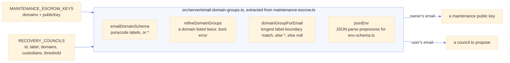

`maintenanceEscrowKeyForEmail` becomes `domainGroupForEmail(entries, email)?.publicKey`, with its tests moved to the shared module, so the matching rules of [Appendix E](architecture.md#appendix-e) are written and tested once. Other parts can follow the same pattern:

- **Boot log.** The server already logs each maintenance key's fingerprint with its domains; it logs each proposed council with its domains and threshold, and the warnings above. A council's fingerprint covers its signed roster, so it is shown in the custodian space and to users, not at boot.
- **Operator documentation.** One README section on "email domain groups", with each variable describing only what it attaches.

**Two variables, not one.** A single `ORGANIZATIONS` variable holding `{ domains, maintenanceKey, council }` reads well but couples two lifecycles: the maintenance escrow is temporary and meant to be turned off ([Appendix E](architecture.md#appendix-e)), while a council is permanent and its membership evolves under signatures ([§10](#governance)); the groupings may also differ (one key per ministry, one council per directorate). Two variables with the same shape and the same code give the consistency without the coupling. The endpoints stay separate too: `/api/maintenance-escrow/assignment` answers a key fingerprint for **any owner** the vault names, unauthenticated, on every encryption, while the council lookup of [§8](#visibility) answers the **signed-in user's own** council at onboarding, with its roster and keys.

**Identifying custodians: `{ userId, email }`.** The candidates compare as follows:

| Identifier          | Stable?            | Problem                                                                                        |
| ------------------- | ------------------ | ---------------------------------------------------------------------------------------------- |
| email               | no                 | reassignable (namesake, departure then hiring), changes (marriage, domain merger)              |
| issuer + sub        | no                 | changes when the identity provider is migrated ([architecture.md Appendix A](architecture.md)) |
| **internal userId** | **yes, by design** | opaque in a configuration file, so a copy-paste mistake is easy                                |

The internal user id ([architecture.md §2.3](architecture.md#s2-3)) is what survives an email change, a new `sub` and a provider migration; even a user who starts over keeps it (only their vault and identity change). It is therefore **authoritative**. The email is a **readability guard**: if the current email of that user id no longer matches the configured one, the council is logged as misconfigured and the change it proposes is not offered for signature, so a wrong id shows up as an error instead of silently splitting secrets to a stranger. An operator command, `npm run council:resolve -- rssi@numerique.gouv.fr`, prints the id to copy (or `SELECT id FROM users WHERE email = '…'`). The last and strongest guard is **acceptance**: a configured person counts only after accepting the role in their interface ([§10](#governance)), so the wrong person refuses, or at least sees the mistake.

**Threshold, as an absolute number.** Validated at boot (**built**): between 2 and 12 custodians, and `1 <= threshold <= custodians.length - 1`, otherwise the server refuses to start. `k = n` is refused: one departure, lost device or absence would make every recovery impossible until the escrows are moved. A threshold of 1 is allowed but logged as a warning: any single custodian can then hand over the only share needed, still in person, which makes it a trusted contact without the wait. More than 12 custodians stops being realistic to coordinate, and every enrolled user carries one capsule per custodian. A percentage reads well but rounds silently (`50%` of 3 is 1 or 2?) and changes meaning when the roster grows, while every existing escrow keeps the threshold it was split with. A margin (`n - k`) of 2 or more is recommended; the boot logs a warning below it.

**Other fields.** `cooldownMinutes` (default 0): minimum time between the start of a recovery and its release, for organizations that want a window in which the user can refuse from their mailbox. `requestTtlDays` (default 7, at most 30): how long a user's recovery request stays open. A per-council MFA policy (`requiredAcr` / `requiredAmr`) was considered; the first version uses the deployment's step-up settings for every council ([§12](#mfa)).

<a id="split"></a>

## 5. Common building block: split the emergency phrase, not the vault

Every Shamir proposal below shares the same escrow, an extension of [architecture.md §8.1](architecture.md#s8-1):

1. The user's open vault generates a fresh emergency phrase `E` (24 words) and derives a **dormant credential** from it, exactly like a trusted-contact escrow: same VRK, its own KEK and auth key.
2. The entropy of `E` (a random scalar of the ristretto255 group, about 252 bits, written as 24 words) is split into `n` shares with threshold `k` (Shamir with Pedersen commitments, [§5.2](#vss)).
3. Share `i` is wrapped to custodian `i`'s active X-Wing key: one **capsule** per custodian.
4. `E` and the shares are discarded. The escrow is signed by the user's identity key over the council id, the roster version and hash, `k`, SHA-256 of the credential's auth public key, SHA-256 of each capsule, a hash of `E`, and the **Pedersen commitments** of the split (so every share can be checked on its own before combining, [§5.2](#vss)).

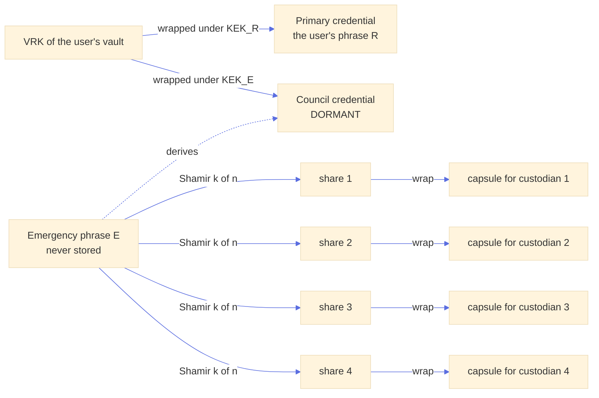

Why split `E` and not something else:

- **Not the VRK.** The VRK is constant for the life of the vault (there is no VRK rotation, [architecture.md §4.4](architecture.md#s4-4)): once reconstructed somewhere, it stays a valid key to every item forever, and nothing can revoke it short of re-encrypting the whole vault. `E` is only a way in: it is useless while its credential is dormant (the server refuses the unlock proof outside an approved session, and serves the vault only to the user's own login), and it is revoked for good by deleting its credential, which the forced phrase change does right after recovery. It also reuses the ordinary cold unlock ([architecture.md §7.2](architecture.md#s7-2)), so recovery adds no new way to open a vault. Against a database leak, `E` is as strong as the VRK (it unwraps the credential's wrapped VRK), so the gain is revocability and server gating, not secrecy.
- **Not the user's phrase `R`.** It dies at every phrase change, and the user would have to give it away.
- **One fresh secret per user**, so a reconstruction exposes one person, never the council's power over everyone (that is what [P4](#p4) gets wrong).

<a id="shamir-figure"></a>

### 5.1 Shamir in one figure

`E` is 32 bytes, and Shamir treats each byte separately, the same way. For one byte and a threshold `k = 2`:

```
  value
    │                 ● share of C (x = 3)
    │            ● share of B (x = 2)
    │       ● share of A (x = 1)
    │  ○  ← the secret byte = where the line crosses x = 0
    └──────────────────────────────── x
```

- Draw a **line** crossing the vertical axis at the secret, with a **random slope**. Each custodian gets **one point** of it: `x` is their slot number, `y` the line's value there.
- **One point says nothing.** Through it pass lines reaching every possible secret, each exactly as likely. This is not "hard to guess", it is information-theoretically empty.
- **Any two points fix the line**, hence the secret (Lagrange interpolation at `x = 0`).
- For a threshold `k`, the line becomes a curve of degree `k - 1` with random coefficients: `k` points fix it, `k - 1` leave every secret equally possible.

The computation runs modulo the order of the ristretto255 group (a prime close to 2^252), so `E` is one number of that size and a share is one number plus a second, blinding one (65 bytes with its `x`); up to 255 custodians are possible. Each user has their own `E` and their own curves, so a custodian's shares of two users are unrelated. A first version computed byte by byte in GF(2^8), as SLIP-39 and HashiCorp Vault's unseal do; it was replaced so that shares could be verified ([§5.2](#vss)).

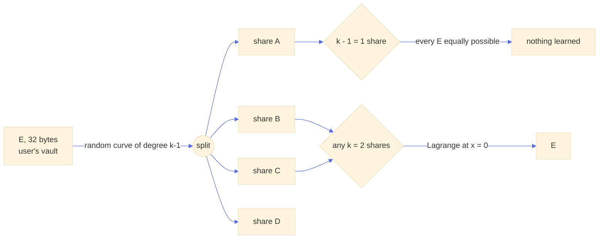

In the recommended flow nobody reads, types or dictates a share: shares only travel wrapped from one vault to another.

<a id="vss"></a>

### 5.2 Verifiable shares (Pedersen)

**The problem.** Plain Shamir cannot tell a wrong share from a right one: combining gives a wrong `E`, and only a final check says so. That is tolerable for a share the user dealt (the user can sign a hash of it), but not for a resharing ([§11.2](#reshare)): a helper's sub-share is part of **every** new share, so one wrong sub-share, by a bug or on purpose, silently ruins the escrow, discovered the day someone is locked out, after the old shares were deleted.

**What verifiable secret sharing adds.** Next to the shares, the dealer publishes one commitment per coefficient of its curve. Anyone can check that a share lies on the committed curve, without learning anything about the secret. Two schemes are standard:

| Scheme   | Commitment to coefficient `a_j`                      | What the commitments reveal                                                                                                                                  | Decision                                                                                                                                                                                 |
| -------- | ---------------------------------------------------- | ------------------------------------------------------------------------------------------------------------------------------------------------------------ | ---------------------------------------------------------------------------------------------------------------------------------------------------------------------------------------- |
| Feldman  | `a_j·G`                                              | `E·G`: safe against today's computers, but a quantum computer turns it back into `E`. The server stores it, so a copy of the database today is `E` tomorrow. | **Rejected**: it would lower the post-quantum level the rest of the design keeps (X-Wing).                                                                                               |
| Pedersen | `a_j·G + b_j·H`, `b_j` a random blinding coefficient | Nothing, against any attacker: every `E` is equally consistent with them. Only the **binding** (no other share passes) rests on a discrete logarithm.        | **Built.** A quantum attacker could at worst make a wrong share pass, which is where plain Shamir already stands, and the hash of `E` in the signed record still catches a wrong result. |

`G` is the group's base point and `H` a second generator obtained by hashing a domain label to the group, so nobody knows how to write one in terms of the other.

**Nothing new implemented in cryptography.** Every operation is libsodium's, constant time: `crypto_core_ristretto255_scalar_*` for the curves, `crypto_scalarmult_ristretto255(_base)` and `crypto_core_ristretto255_add` for the commitments, `crypto_core_ristretto255_from_hash` for `H`. The file `src/crypto/shamir.ts` only arranges them (Horner evaluation, Lagrange weights), about 300 lines with property tests and a frozen vector. No library offers Pedersen VSS ready-made in the browser; the ones that do (threshold-signature toolkits) bring a much larger surface for the same few lines.

**The broadcast pitfall.** Verifiable sharing assumes everybody checks against the **same** commitments. Published analyses of Feldman-style schemes show forgeries when that "broadcast" is implemented loosely, for instance when a dealer can show different commitments to different recipients. Here the server is the channel and is not trusted, so:

- the user's commitments are inside the escrow record the user signs; every vault checks that signature before using them;
- a helper's commitments are signed by the helper and bound to the session, the escrow, the target version and the helper's slot; the server keeps exactly one set per helper and escrow;
- the constant terms are anchored: the server and every vault check that each helper's first commitment is its Lagrange weight times the current commitments evaluated at its slot, and that the helpers' first commitments add up to the one the **user** signed. A server inventing helpers or commitments would need shares it does not have.

**Where each check runs.**

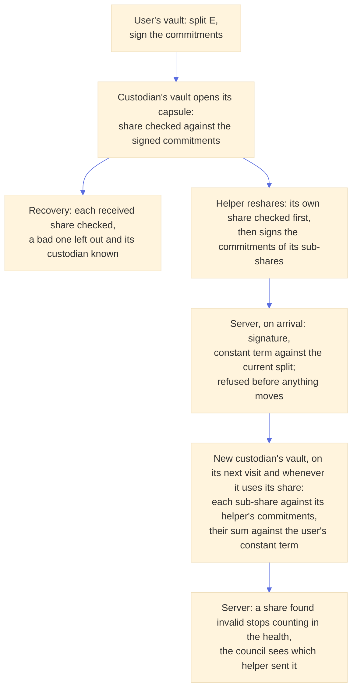

**The case the server cannot see.** A helper that signs correct commitments and then seals, for some recipients, values other than the committed ones passes the server's check, which cannot read sub-shares. Done for one recipient, it costs that recipient's share; done for every recipient, every new share contains the bad sub-share and the escrow is lost. Each new custodian's vault therefore **checks the shares it received in the background whenever the custodian opens their space**, without any click (it is a check, not a decision): a share found invalid stops counting in the escrow's health, so its user is asked to set up again when too few valid shares are left, and the custodian space names the helper that sent it, so the council can remove them. Only escrows that verify under their owner's identity are judged, so a server cannot get an honest helper blamed with a forged record. A custodian lying about the result gains nothing they could not get by refusing to contribute.

**Why not split the 24 words themselves** (each custodian gets 6 words): that is not Shamir. It needs **all** pieces (no threshold, one departure blocks everything), each piece reveals part of the secret (three colluders holding 18 words have far less left to guess), and the user must know which words go where. A real Shamir share is as large as the secret: 32 bytes plus an index, about 25 words each. SLIP-39 does exactly that, and a "dictated shares" variant is possible ([P3-bis](#p3bis)).

The server side reuses `VaultCredential` with a new type `council`, a `council_escrows` row per (user, council) and one `council_capsules` row per custodian slot. Nothing in the vault format changes.

<a id="proposals"></a>

## 6. Proposals

The proposals differ in **where the shares meet**, and therefore who ever sees `E`. Shamir needs `k` shares **in one place** to rebuild the secret; there is no way to "reconcile at everybody's" without everybody seeing `E` (P2-bis) or without multi-party computation, which is out of proportion here. The best single place is the user's own browser.

<a id="p1"></a>

### P1. Approval quorum, no Shamir (baseline)

Each custodian holds a **full** capsule of `E`, like `n` trusted contacts without a wait. The server releases the credential once `k` custodians have approved with their identity signature.

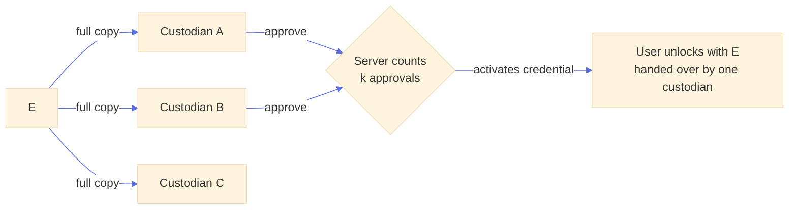

- **For**: trivial, no new cryptography.
- **Against**: the quorum is **server policy only**. Any single custodian can already decrypt `E` from their capsule; one custodian plus a compromised server is enough. "k of n" is a promise, not a property.
- **Verdict**: comparison only. If we accept that, a trusted contact with a short wait is equivalent.

<a id="p2"></a>

### P2. Shamir, combined by one custodian

Each approving custodian unwraps **their** share and re-wraps it to **one custodian's** encryption key (the initiator, or the last approver). That custodian's vault combines the shares, checks the result against the signed commitment, and shows `E` as a Kit, a "temporary recovery key" handed over to the user in person. Variant **P2-bis**: every approver re-wraps to every other participant, so all of them see `E`.

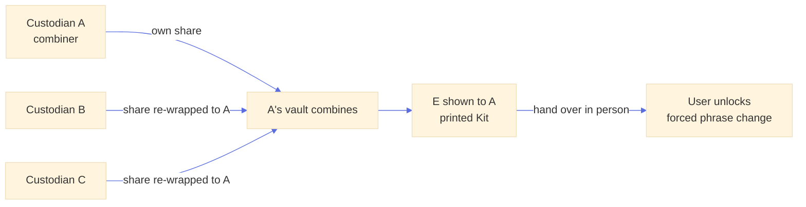

- **For**: the user needs no browser session during the approvals; the Kit is an object users already know.
- **Against**: the combiner (or, in P2-bis, every approver) **learns `E`**. Until the user's forced phrase change burns it, the combiner plus the user's login opens the vault, and in an organization the custodians often control the identity provider. P2-bis multiplies the holders of a live credential for no gain.
- **Verdict**: fallback for a user who cannot sit at a computer, not the default.

<a id="p3"></a>

### P3. Shamir, combined in the user's browser (recommended)

The shares meet **only in the locked-out user's own browser**. At the start of the request, the user's vault generates an **ephemeral X-Wing key pair**; custodians re-wrap their share to it. Once `k` shares arrive, the user's browser combines them, unlocks with `E`, and is forced into a phrase change that burns the council credential and re-arms a fresh escrow. **No custodian ever sees `E`, and nobody needs to see it at all.**

The ephemeral public key reaches custodians **through the server**, so a custodian cannot tell by themselves whether it was generated by the real user's browser, by someone using a stolen login, or substituted by a compromised server. The protection is a human check: a custodian compares the key's fingerprint (40 digits or a QR) with the screen of a person they recognize, the device-pairing pattern of [architecture.md §7.5](architecture.md#s7-5). [§7](#flow) makes that check bear on the **last** share only, which keeps the guarantee cryptographic while asking one meeting instead of `k`.

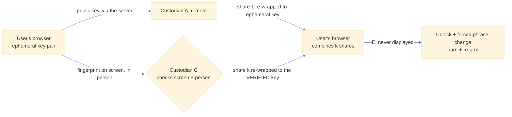

**Why the quorum can replace the wait.** The wait of trusted contacts exists because a stolen login could otherwise start a recovery and the only defence is the real user noticing. Here a stolen login can start a request and even collect remote approvals, but it gets the last share only if a custodian, facing the person, recognizes them and sees that key on their screen. That is a stronger barrier than a wait, and it is immediate. Organizations that want a window anyway set `cooldownMinutes`.

<a id="p3bis"></a>

### P3-bis. Dictated shares (SLIP-39 style)

Same principle without an ephemeral key or a server relay: each custodian, in person or on a video call, reads **their share** as a ~25-word mnemonic (with a checksum, as in SLIP-39), and the user types it; the user's browser combines. The human check is implicit (you dictate to the person you recognize). Against: `k × 25` words to type, typing errors, and shares spoken in the clear over a call (acceptable, since a share alone is worthless). Kept as an offline fallback (custodian's interface down, network trouble), not the default.

<a id="p4"></a>

### P4. One council key pair, split once (rejected)

The council is a principal with one X-Wing key pair whose private key is Shamir-split between custodians once; each user wraps `E` to the **council public key** (one capsule, nothing to re-arm when a custodian leaves). This is 1Password's Recovery group, or the maintenance phrase split between custodians as [architecture.md Appendix E](architecture.md#appendix-e) recommends.

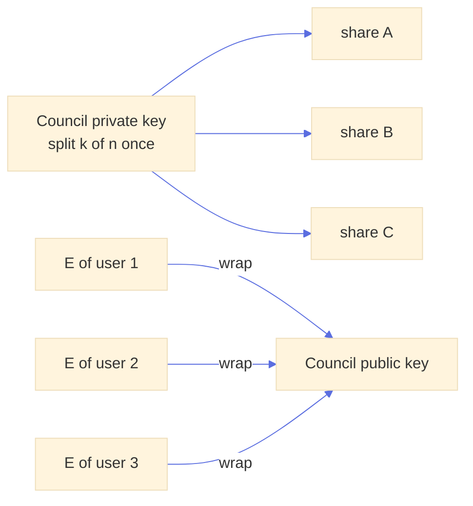

- **For**: membership changes are a council-only operation, invisible to users; one capsule per user.
- **Against**: recovering **one** user requires reconstructing the **council private key** somewhere, and whoever holds it at that moment can open the `E` of **every** user. One recovery exposes the whole organization. Avoiding the reconstruction needs threshold decryption, which X-Wing (ML-KEM) does not offer in any usable library today.
- **Verdict**: rejected. It is the maintenance escrow's model, right for a batch tool kept in a safe, wrong for a routine per-person operation.

### Comparison

|                                    | P1 approvals            | P2 one combines           | **P3 user combines**       | P3-bis dictated     | P4 council key                      |
| ---------------------------------- | ----------------------- | ------------------------- | -------------------------- | ------------------- | ----------------------------------- |
| Shares meet in                     | (no shares)             | a custodian's browser     | **user's browser**         | user's browser      | wherever the council key is rebuilt |
| Who sees `E`                       | every custodian can     | combiner (all, in P2-bis) | **nobody**                 | nobody              | the holder sees every user's        |
| One custodian + server can recover | yes                     | no                        | no                         | no                  | no                                  |
| Stolen login alone gets            | nothing (server policy) | nothing                   | **at most `k - 1` shares** | nothing             | nothing                             |
| Immediate                          | yes                     | yes, plus a handover      | **yes, one meeting**       | yes, `k` dictations | yes                                 |
| Custodian departure                | delete one capsule      | delete one capsule        | delete one capsule         | delete one capsule  | reshare the council key             |

<a id="flow"></a>

## 7. Recommended flow: remote approvals, last share in person

The user starts; custodians are notified by email and approve **remotely**; the user only sees "request in progress", then "go and see one of these people"; the person they meet checks their screen and contributes **the last share**.

What the meeting is **not**: the custodian does not hand over a temporary key (that would be P2, someone saw `E`). They **confirm** the user's screen and give the last share to it. The user's experience is the same sentence, "go and see one of these people", with a stronger property: until the meeting, whoever holds the request has `k - 1` shares, which mathematically reveal nothing about `E`.

### 7.1 State machine

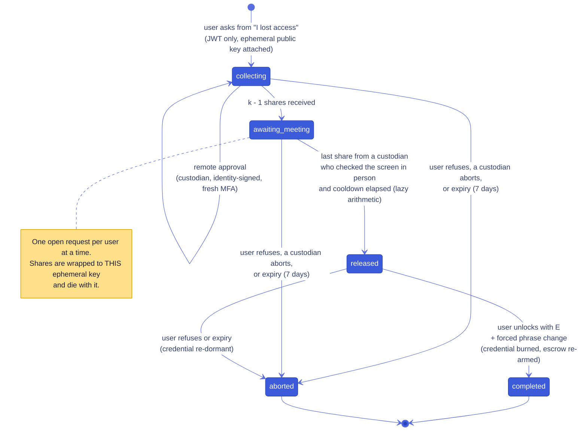

A custodian can also **open** a request on behalf of a user who called them (identity-signed); the user's interface then shows "a recovery was started for you" and attaches its ephemeral key, and the flow continues at `collecting`.

### 7.2 What the user sees

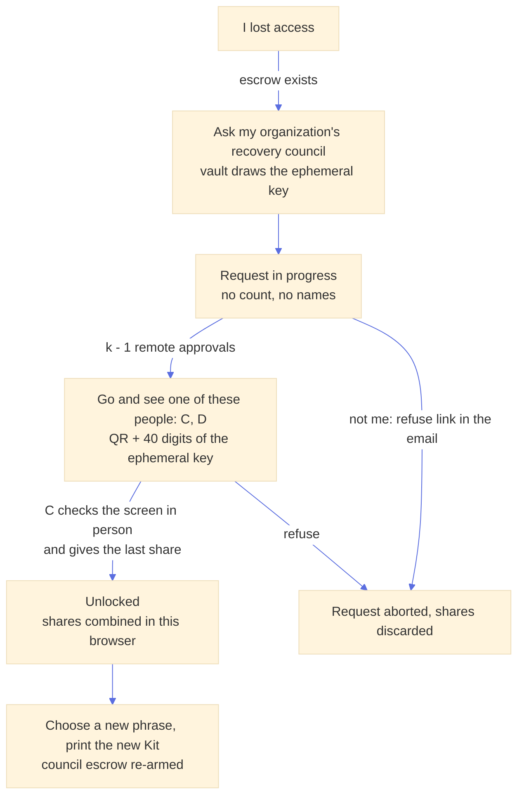

1. **"I lost access"** ([architecture.md §7.8](architecture.md#s7-8)) offers "ask your organization's recovery council" when an escrow exists. The vault generates the ephemeral key pair (private key in the vault's IndexedDB, never in the interface) and opens the request.
2. **"Request in progress."** No count, no names of who approved. An email confirms the request to the user's address (if it was not them, the email has a link to refuse, which needs only a login, fail-safe as in [architecture.md §8.2](architecture.md#s8-2)).
3. **"Go and see one of these people: C, D."** Shown at `awaiting_meeting`, listing the custodians who have **not** contributed yet (only they can give the last share). It reveals by complement who approved, which is acceptable. The screen also shows the ephemeral key's QR and 40 digits.
4. **"Unlocked."** The screen polls every few seconds while it is on the meeting step; once released, the browser fetches the wrapped shares, combines, checks, unlocks, and goes straight to "choose a new phrase, print your new Kit".

**No real-time push is needed for the user.** A check when the page opens or regains focus is enough, plus short polling on the meeting screen only. (Note for any later push: the native `EventSource` API cannot send an `Authorization` header and the interface authenticates with a bearer token, so a stream would use `fetch()` with a streamed body; and the in-memory listener registry of `src/server/vault-notify.ts` spans one process, so several instances would need PostgreSQL `LISTEN/NOTIFY`.)

**If the user's own screen shows nothing at the meeting** (the open request was not started from this browser, for example by someone with a stolen login), the interface says so explicitly and offers to refuse it, which aborts the request and discards its shares. The custodian, seeing a key that matches nothing on the user's screen, does not contribute.

### 7.3 What custodians see and do

Custodians are notified by **email**, which is how they learn about a request; their interface lists open requests across all their councils ([§8](#visibility)). A remote approval means "this request is legitimate as far as I know" (the user called, a ticket exists): it does **not** require seeing the user, because a single share is worthless. The in-person step is the one that binds.

### 7.4 Sequence

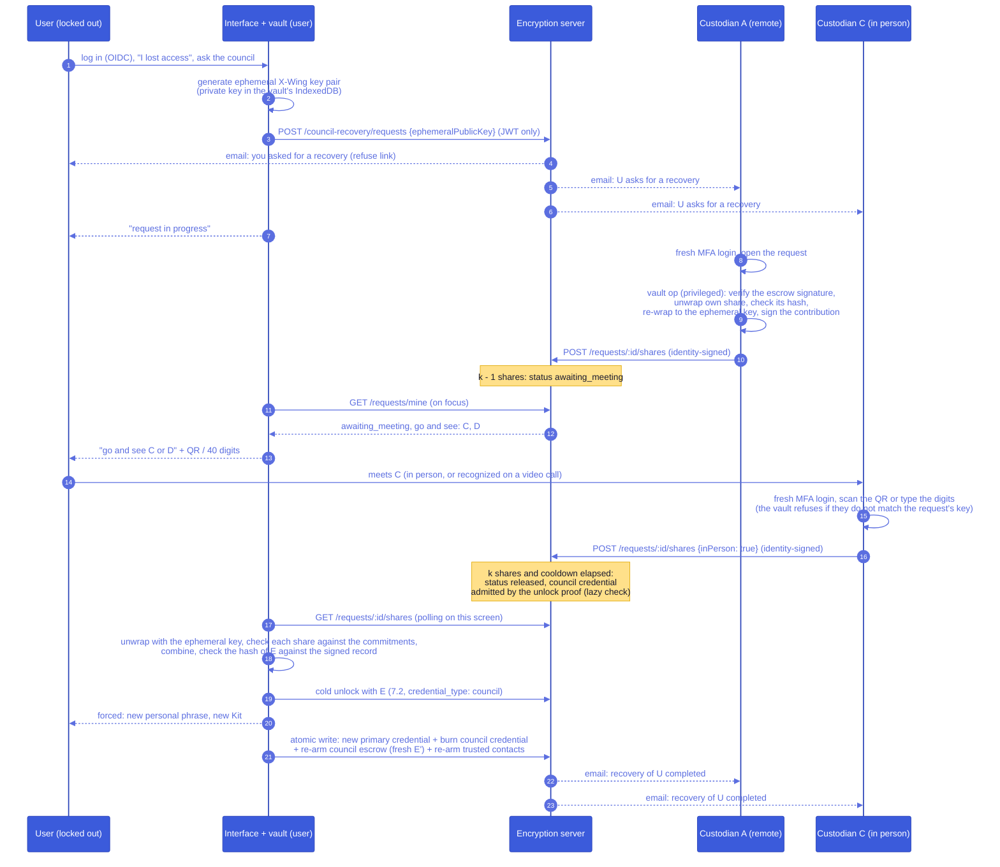

**Contribution signature.** Each contribution is signed by the custodian's identity key over the request id, the user id, SHA-256 of the ephemeral public key, SHA-256 of the wrapped share and the `inPerson` flag (context `lasuite-encryption/council-share/v1`). After recovery, the user's vault shows "recovered on 8 October 2026 with the approval of A and, in person, C" and verifies the signatures, so a server that released without real approvals is caught afterwards.

**What the user's login alone can do**: open a request, fetch wrapped shares, refuse. It never yields more than `k - 1` shares without a person in front of a custodian. **What a custodian alone can do**: open, contribute, abort. A contribution is useless without `k - 1` others and the ephemeral private key.

<a id="visibility"></a>

## 8. Who is a custodian, and what each client learns

A user is a custodian of a council when they are in the **head of its roster chain** (stored in the database, [§9](#roster)), and is **invited** to become one when the configuration names them in a change not yet signed ([§10](#governance)). The configuration is parsed server-side only and never sent to a browser.

The frontend never receives the list of custodians' user ids. Each client gets exactly what its role needs:

| Who                                     | Endpoint                              | Receives                                                                                                                                                                                                                                                                                                         | Never receives                                         |
| --------------------------------------- | ------------------------------------- | ---------------------------------------------------------------------------------------------------------------------------------------------------------------------------------------------------------------------------------------------------------------------------------------------------------------- | ------------------------------------------------------ |
| Any user                                | `GET /api/councils/mine`              | the councils where **they** are custodian or invited: id, label, role (`custodian` / `invited`), `k`, `n`                                                                                                                                                                                                        | anything about councils they are not part of           |
| A custodian, for their councils         | same response, custodian part         | the other custodians (name, email, fingerprint, status: active, reset, invited), the council's health ([§11.5](#margin)), the pending change to sign, the open requests                                                                                                                                          |                                                        |
| A user accepting a council or re-arming | `GET /api/councils/for-me`            | the council matching their email: id, label, the signed roster chain (each member's slot, user id, identity key and display name, and the signatures), and the state of their own escrow; the vault fetches each custodian's encryption key from the directory and checks it against the identity the chain pins | emails of custodians                                   |
| A user with an open request             | `GET /council-recovery/requests/mine` | status; at `awaiting_meeting`, the names of the custodians who have not contributed yet                                                                                                                                                                                                                          | the count of approvals before that point, who approved |

An empty `/api/councils/mine` means "not a custodian", and the interface hides the whole custodian section. The **names** of a council's custodians are shown to the users it covers, because they accept the council knowing who is in it and will have to go and see them ([§11.6](#late-council)); organizations usually publish the list anyway. What stays server-side is the user ids.

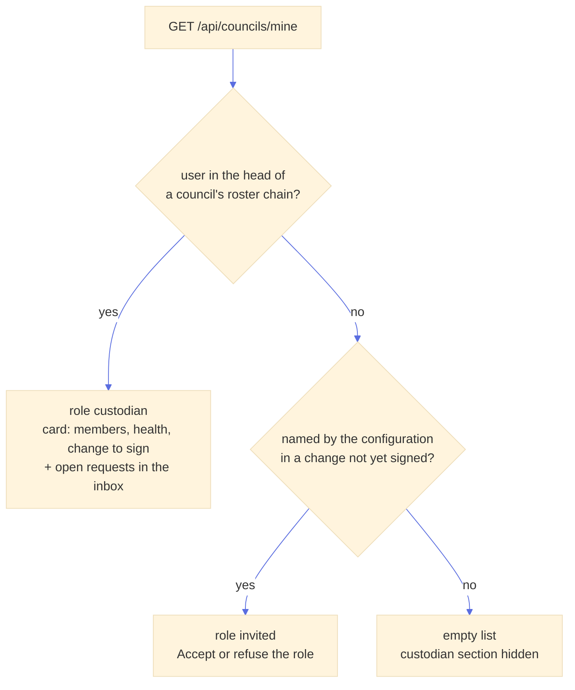

`for-me` does carry each custodian's internal user id: the directory's key binding signature covers the user id, so the vault cannot verify a custodian's encryption key without it. It says nothing a name does not, and only to the users the council covers; `/api/councils/mine`, the only council endpoint every user calls, still tells a non-custodian nothing.

**Custodian of several councils.** Allowed and expected (a ministry's RSSI on the councils of several directorates). The interface keeps it simple:

- **One inbox** of open requests across councils, each labelled with its council, sorted by age.
- **One card per council** in the custodian settings: members, health, pending change to sign.
- Every action names the council it acts on, and the MFA step-up ([§12](#mfa)) applies per action, so acting on two councils in a row does not reuse a stale authentication.
- The server stores one capsule per (user escrow, slot), so being in several councils changes nothing cryptographically; a person in two councils simply holds shares of different users' escrows.

<a id="roster"></a>

## 9. How the user trusts the council

**Why it matters.** The user's browser wraps each share to the custodians' public keys, and those keys come from the server. A compromised server, or anyone able to edit the database, could slip in their own keys, receive the shares and rebuild `E`. That breaks [architecture.md §3.1](architecture.md#s3-1) (a compromised server cannot get access). The critical moments are when the user accepts the council at onboarding and every silent re-arm afterwards. Accepting the list without any check would be trust on first use, which the design rules out elsewhere ([architecture.md §5.4](architecture.md#s5-4)).

**One fingerprint for the whole council.** The roster is `{councilId, version, k, custodian identity public keys sorted}`; its fingerprint is `SHA-256` of its framed encoding, truncated to 128 bits and shown as 40 digits, the usual format ([architecture.md §4.3](architecture.md#s4-3)). Truncating a hash loses no useful entropy: it is exactly how individual fingerprints are made. It must be a **hash, not a sum**: a sum of keys is malleable (an attacker adjusts one key so the total stays the same), a hash is not. The organization publishes this fingerprint outside the service (intranet page, onboarding email from the RSSI, welcome pack). The user compares it once when accepting the council, and the vault pins the council in its TOFU registry as `trusted`.

**A roster chain signed by custodians.** Every later roster version (a custodian joins, leaves, resets, `k` changes) must be signed by a **strict majority of the custodians of the previous version, never fewer than its `k`** (context `lasuite-encryption/council-roster/v1`). The user's vault walks the chain from the pinned version, so membership changes need no new check from users, and the server alone cannot forge a version. This is Keybase's team sigchain reduced to one operation.

```mermaid
%%{init: {'theme':'base','look':'classic','themeVariables':{'lineColor':'#5b6ee0','edgeLabelBackground':'#ffffff','clusterBkg':'#f5f7ff','clusterBorder':'#9aa7e8','titleColor':'#1a1a2e'},'themeCSS':'.edgeLabel p{background-color:#ffffff;color:#444;font-style:italic;border:1px solid #b5b5b5;padding:2px 8px;border-radius:10px;margin:0;} .edgeLabel .labelBkg{background:transparent;}'}}%%
flowchart LR
  P[Fingerprint published<br/>by the organization] -.->|compared once by the user| V1
  V1[Roster v1<br/>A B C D, k=2] -->|signed by 3 of v1, a majority| V2[Roster v2<br/>A B C G, k=2<br/>G replaces D]
  V2 -->|signed by 3 of v2| V3[Roster v3<br/>A B C G'<br/>G reset, new key]
  V3 -.->|vaults walk the chain| U[Custodians reshare to v3<br/>users' vaults verify it]
```

**Transparency log (later).** A public append-only log of roster versions does not prevent a substitution but detects it, and here the monitors are already known: each custodian's interface checks that every published roster version of their councils lists **their** real key and no unexpected one. Its main value is against the stealthiest attack, a server showing a forged roster to **one** targeted user only (split view). With such a log and custodian monitoring, the user-side fingerprint comparison could become optional.

**An organization signing key** that certifies the roster was considered: users would then have to trust that key, which moves the same problem one step up.

**Recommendation for a first version**: the council fingerprint compared at acceptance, plus the chain. Without the comparison, the documentation must say plainly that the council is trusted on first use.

<a id="governance"></a>

## 10. Governance: the configuration proposes, the custodians decide

The authority on membership is the **roster chain** in the database. The environment variable is only a **proposal**. This gives the rules:

- **Nothing destructive without the custodians' signatures.** If the variable is empty, invalid or missing, the server deletes nothing and stops no recovery. It logs an error, and custodians see "the configuration does not match the registered council; no membership change possible". Recoveries keep using the head of the chain. A missing variable never dissolves a council.
- **A difference between the variable and the chain head is a pending change.** Custodians see "add G, remove D, proposed by the configuration" in their interface and sign it, a strict majority of them and never fewer than `k`, each after a fresh MFA login. A new custodian must appear in the variable first, then the others "promote" them by signing.
- **The newcomer accepts too.** Their interface shows "you are named custodian of council X"; they accept (or refuse, which surfaces a configuration mistake). The signers check the newcomer's identity fingerprint like any out-of-band verification; they are colleagues, a call is enough.
- **Replacement is one step.** A single edit of the variable replaces D by G, and a single roster version says "G replaces D". No 6, then 7, then 6 again. The signers can be any custodians of the previous version, D included if still around.
- **Bootstrap (decided: all).** The very first roster version cannot be signed by a previous one, so it is signed by **all** its custodians, each vouching for their own key: a server that slipped a wrong key in for one of them never gets that person's signature, and the council never takes effect. One absent person delays the creation, which is the right trade at that moment. The alternative, active once `k + 1` have accepted with the others joining later, is kept in mind for very large councils. Its fingerprint is what the organization publishes.

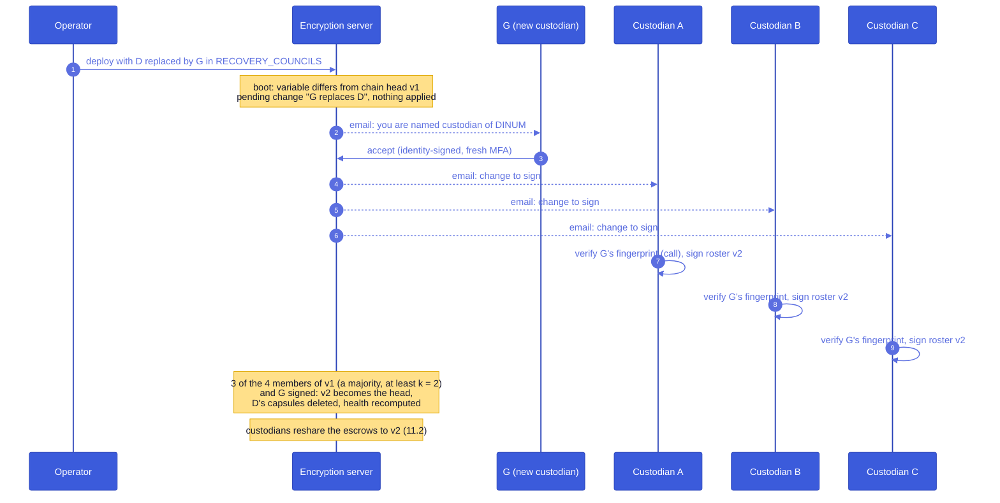

A **proposed roster version** goes through these states:

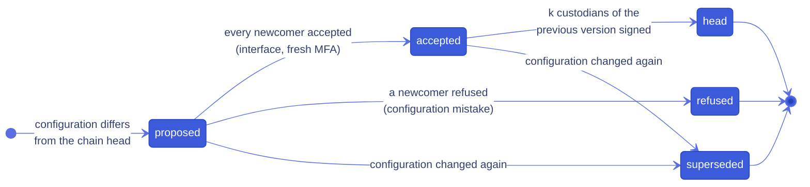

A proposal has no expiry: it waits for its signatures. A configuration that changes again replaces it, and the signatures already given are discarded, since they covered another roster.

<a id="manual"></a>

### 10.1 Manual actions only

A compromised product (Docs, Drive, or a script injected into one) talks to the vault with the product origin. Every council decision is therefore a **privileged vault operation**, refused to any origin but the interface's (`PRIVILEGED_OPERATIONS`), and the interface performs it only after an explicit click on a screen that names the council and the people concerned. Custodian actions also require a fresh authentication ([§12](#mfa)) and are signed by the custodian's identity key, which lives in the vault.

| Action                                                                     | Who       | Where                            | Can a compromised product trigger it?                                                                                |
| -------------------------------------------------------------------------- | --------- | -------------------------------- | -------------------------------------------------------------------------------------------------------------------- |
| Accept a council, compare its fingerprint                                  | user      | interface, privileged            | no                                                                                                                   |
| Ask for a recovery, refuse one                                             | user      | interface                        | no (the user's own login, outside any product)                                                                       |
| Accept or refuse the custodian role                                        | custodian | interface, privileged, fresh MFA | no                                                                                                                   |
| Sign a roster version (promotion, replacement, re-admission after a reset) | custodian | interface, privileged, fresh MFA | no                                                                                                                   |
| Contribute a share, abort a request                                        | custodian | interface, privileged, fresh MFA | no                                                                                                                   |
| Reshare escrows to a new roster                                            | custodian | interface, privileged, fresh MFA | no                                                                                                                   |
| Set up again after too many departures, or re-arm after a recovery         | user      | interface, privileged            | no (the user's explicit click; with the considered silent re-arm, a product could have caused one, never steered it) |

The configuration, the server and the products can propose; only people, in the interface, decide.

<a id="lifecycle"></a>

## 11. Lifecycle

**Changing membership never reconstructs a secret.** There is no council-wide key; each user has their own `E`. Two mechanisms can move escrows to a new roster, and neither rebuilds `E` anywhere.

**Decided: the council does it.** Depending on every user coming back to update their escrow was rejected: some never come back, and they are exactly the ones a council exists for. Resharing ([§11.2](#reshare)) is the mechanism of every membership change, run by the custodians in batches; the silent re-arm ([§11.1](#rearm)) is kept below as the considered alternative. A user's own vault draws a new `E` in two cases only: the forced phrase change after a council recovery, and an **explicit** "set up again" offered in their settings when too few custodians can still open the escrow. That state is computed from the **signed** head and the custodians' current identities, never from the configuration, so a broken or emptied variable never makes an escrow look lost.

**Rotation at a glance**, for "G replaces D" in a council of 2 of 4:

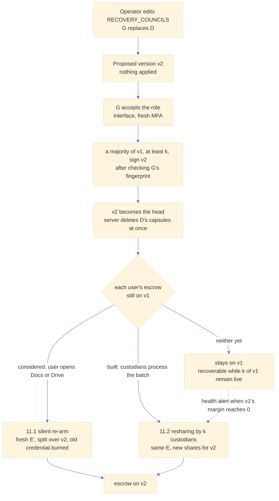

Seen from one user's escrow:

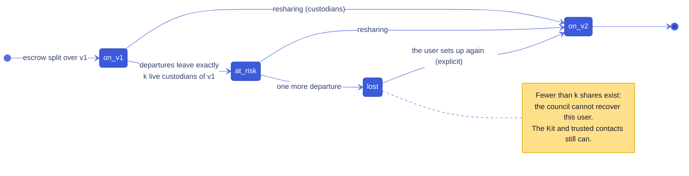

<a id="rearm"></a>

### 11.1 Silent re-arm by the user's vault (considered, not built)

Re-arming needs an **open vault**, not the user's phrase, and every enrolled device has one. At the next page load in Docs or Drive, the vault sees that its escrow targets an older roster version, walks the chain ([§9](#roster)), draws a fresh `E'`, splits it over the new roster, and replaces the old credential and capsules in one write (as trusted contacts are re-armed, [architecture.md §8.6](architecture.md#s8-6)). No screen, no click: ten thousand users are not disturbed, their escrow updates on their next visit.

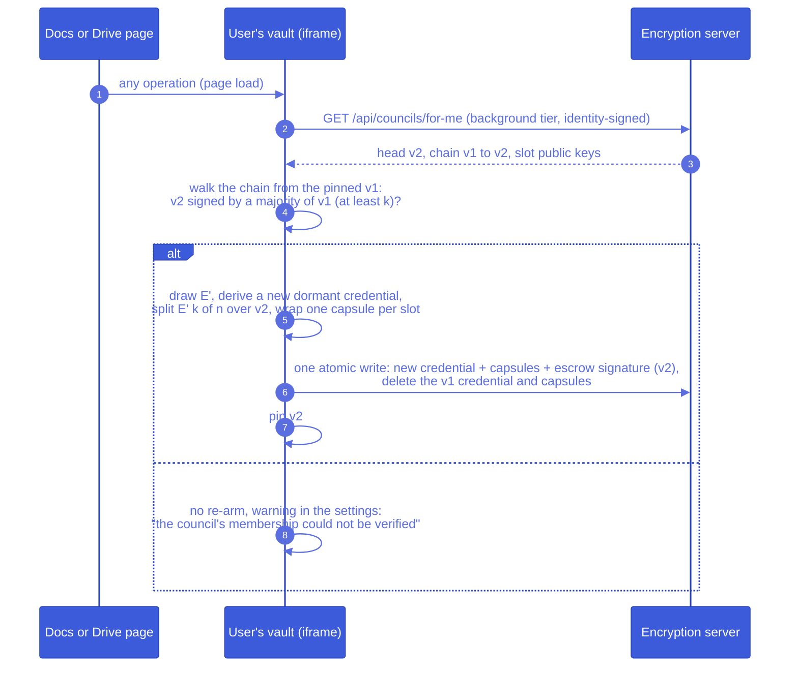

The product only causes the vault to run; it sees nothing of the exchange and cannot choose the roster. Since the old credential is deleted in the same write, every share of the old `E` (including those a departed custodian might have kept) becomes worthless.

<a id="reshare"></a>

### 11.2 Resharing by custodians (built: the mechanism of every change)

Users who never return keep an escrow on an old roster version. It stays recoverable as long as `k` of that version's custodians remain live. To move them anyway, custodians can **reshare** without the user and without rebuilding `E` (Desmedt-Jajodia redistribution):

1. `k` custodians of the old version each take their share `s_i`, check it, multiply it by its Lagrange coefficient, split the result into new shares for the new roster with commitments of their own, sign those commitments, and wrap one sub-share to each new custodian.
2. The server checks each helper's signature and constant term ([§5.2](#vss)) and refuses a wrong one before anything moves.
3. Each new custodian adds the sub-shares they received: the sum is a valid share **of the same `E`** on a new polynomial, and the sum of the helpers' commitments is the new split's commitments, with the constant term the user signed.
4. Old capsules are deleted at once. Keeping them for a few days "to be safe" was considered and rejected: a departed custodian's share would stay usable meanwhile (with `k - 1` others on the old curve), and the checks above catch at the time of the resharing what the old capsules would have been kept for. Deleting them revokes the old shares on the server only: a custodian who kept a copy keeps a valid share of the same `E` ([§11.8](#not-revoked)). Database backups still contain old capsules: their retention must be limited (README).

Nobody ever sees `E`. It runs as a batch in the custodian's vault: for 10,000 users, a few X-Wing operations per user per participant, on the order of a minute (to measure).

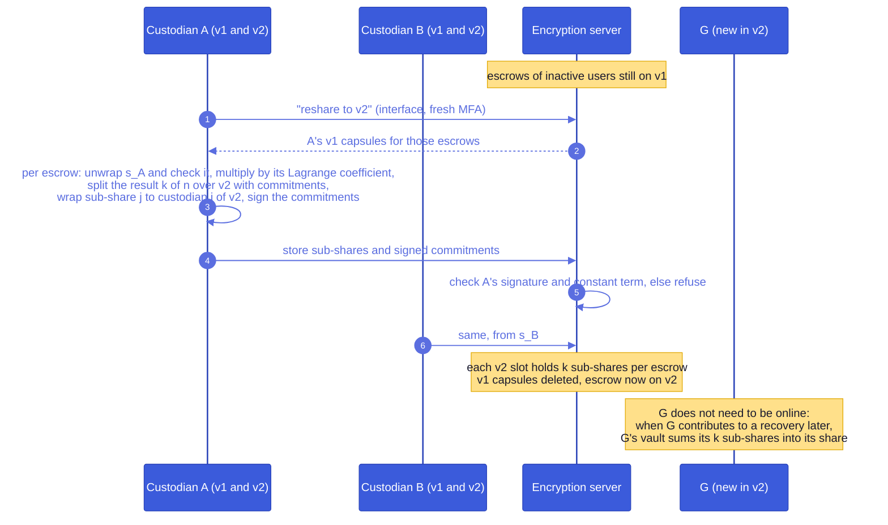

**New custodians stay passive.** A new custodian's share is the sum of the `k` sub-shares they received, and nothing requires that sum to be computed during the resharing: their vault adds them up when they contribute to a recovery. Only the `k` resharing custodians must act.

**Checked shares, also after a resharing.** The user never saw the new shares, but they lie on commitments whose constant term the user signed, so every share stays checkable on its own ([§5.2](#vss)). A first version without commitments could only check the final result, and a wrong sub-share from one helper then ruined every new share of the escrow; that is why the scheme was changed.

<a id="handover"></a>

### 11.3 Why a departing custodian cannot simply hand over their share

The intuitive passation is "D gives their part to G": D's vault unwraps D's capsules and wraps the same shares to G. It is easy, but:

- **Nothing is revoked.** The shares are unchanged and D has had each of them in clear in their vault; whatever D kept still combines with `k - 1` other shares of the **current** split.
- **It needs D**, present and cooperative, which a departure (or a dismissal, an illness) often rules out.
- **It touches every escrow anyway**: D holds one capsule per user, so a handover is as much a batch as a resharing.

A real passation must change the shares themselves:

| Mechanism                       | Needs D | Needs the user | D's old share afterwards                                            | Reaches inactive users |
| ------------------------------- | ------- | -------------- | ------------------------------------------------------------------- | ---------------------- |
| Handover (D to G)               | yes     | no             | **still valid** with `k - 1` current shares                         | yes                    |
| Resharing ([§11.2](#reshare))   | no      | no             | combines only with `k - 1` **old** shares, which the server deleted | yes                    |
| Silent re-arm ([§11.1](#rearm)) | no      | a visit        | **worthless** (`E` burned)                                          | no                     |

The handover is therefore not offered. Resharing plus re-arm cover the same need without D and revoke D's share.

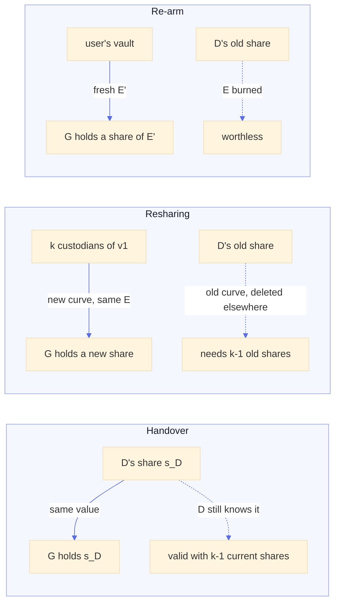

### 11.4 Events

- **A custodian leaves.** Roster change ([§10](#governance)). The server deletes their capsules at once, so they can no longer obtain a share. Escrows stay recoverable through the margin, and [§11.1](#rearm) moves them to the new roster. A departed custodian who saved an unwrapped share earlier still needs `k - 1` others from the **same** split, which re-arming invalidates.
- **A custodian resets their vault** (lost everything, starts over, [architecture.md §7.8](architecture.md#s7-8)). Same user id, **new identity**: their capsules target keys that no longer exist, so they are **lost to the council while still in the configuration**. The server detects a new identity without continuity link for a custodian's user id and notifies the other custodians: "B reset their vault, their shares are lost, margin now 1". Re-admission needs no configuration change, since it is the same person: a new roster version "new key for B", signed by a majority of the previous version (never fewer than `k`) after checking B's new fingerprint. Then [§11.1](#rearm) or [§11.2](#reshare) give B fresh shares.
- **A custodian's identity changes legitimately** (continuity chain, [architecture.md §5.4](architecture.md#s5-4)): the chain walk keeps their slot; nothing to do.
- **A custodian's encryption key rotates**: their old key stays in their vault, so their capsules still open; the next escrow or resharing targets the new key.
- **A custodian joins**: roster change; their shares arrive with the next resharing.
- **The user changes phrase, or recovers through a trusted contact.** Nothing to do for the council: `E` is independent of the user's phrase and was never revealed. Only a council recovery burns it, and the forced phrase change that follows re-arms it (`council_rearm`), or leaves the council explicitly (`council_drop`) when its membership no longer verifies; any later phrase change does the same if that one was left unfinished.
- **The user starts over.** Like trusted contacts, the escrow stays on the dormant vault (anti-lockout against a stolen session); the new vault gets a new escrow at onboarding.
- **The user leaves the council's domain.** Nothing automatic: the escrow names its council. The settings show it and offer to switch when another council matches.

The custodian reset, step by step:

```mermaid
%%{init: {'theme':'base','look':'classic','themeVariables':{'actorBkg':'#3b5bdb','actorTextColor':'#fff','actorBorder':'#2942b8','signalColor':'#5b6ee0','signalTextColor':'#5b6ee0','noteBkgColor':'#ffe08a','noteTextColor':'#1a1a2e','noteBorderColor':'#e0a800','sequenceNumberColor':'#fff'}}}%%
sequenceDiagram
  autonumber
  participant B as Custodian B
  participant API as Encryption server
  participant A as Custodian A
  participant C as Custodian C
  B->>API: starts over (new vault, new identity, no continuity link)
  Note over API: B's slot targets a key that no longer exists:<br/>B's shares are lost, margin of every version down by one
  API-->>A: email: B reset their vault, margin now 1
  API-->>C: email: B reset their vault, margin now 1
  API-->>B: interface: you are custodian of DINUM, re-admission needed
  A->>B: call: compare B's new fingerprint
  A->>API: sign roster v3 "new key for B" (interface, fresh MFA)
  C->>API: sign roster v3 (after the same check)
  Note over API: v3 is the head, a resharing<br/>gives B fresh shares, margin restored
```

<a id="margin"></a>

### 11.5 Margin and health

- **Boot rule**: `n >= k + 1` mandatory, `n >= k + 2` recommended. With 2 of 4, two departures are absorbed.
- **Health, visible to custodians** for each roster version still in use: how many escrows, and how many of their slots still target live keys. An alert when a version's margin reaches 0: "one more departure would make the recovery of X users impossible". The fix is a replacement, then the re-arms.
- **An absence of unknown length** (long illness, extended leave) is handled the same way: replace ahead of time rather than wait.
- **Two departures at once** with a margin of 1: the users who re-armed since the first departure are safe; the others are recoverable only by a reshare done **before** the second departure, which is exactly what the health alert is for.

<a id="late-council"></a>

### 11.6 A council created after the user

A council can be set up, or a user's domain covered, long after the user's onboarding. Joining it needs an **open vault**, as a re-arm does, but the **first** acceptance is a decision: it is the moment the user trusts the council, so it is never silent and never done from a product.

**Built.** A row in the interface's settings home and the `recovery-council` settings section, which LaSuite Accounts can open from its encryption page. A user creating their keys sees the council during onboarding. Docs and Drive show nothing: they have no reason to know about councils.

**How users learn about it (to discuss).** Nothing tells a user who already has keys that a council now covers them. The message carries nothing secret ("your organization set up a recovery council, open your encryption settings to accept it"), and accepting still requires comparing the fingerprint, so the email itself is not a security mechanism. Three ways:

| Option                                          | How                                                                                                                                                                                          | For                                                              | Against                                                                                           |
| ----------------------------------------------- | -------------------------------------------------------------------------------------------------------------------------------------------------------------------------------------------- | ---------------------------------------------------------------- | ------------------------------------------------------------------------------------------------- |
| The organization's own channel                  | `npm run council:resolve`-style command exports the users covered and not enrolled; the organization writes to them                                                                          | no code in the service, the organization's own words and channel | manual, and the list ages                                                                         |
| A `notifyUsers` flag on the council entry       | when a version comes into force, the service emails the covered users without an escrow, once per user and council (a `notified_at` per user)                                                | automatic, only who is concerned                                 | a change of the variable can send tens of thousands of emails at once                             |
| The same flag, drained by a job at a fixed rate | the flag queues the users; a periodic job sends a fixed number per run (for instance 500 an hour) until the queue is empty, and stops when the council loses its head or the flag is removed | automatic, smooth for the mail server, stoppable midway          | a job and a queue to run (the service has none today: everything else is computed lazily on read) |

Users without keys yet need none of this: they see the council when they create their keys.

```mermaid
%%{init: {'theme':'base','look':'classic','themeVariables':{'actorBkg':'#3b5bdb','actorTextColor':'#fff','actorBorder':'#2942b8','signalColor':'#5b6ee0','signalTextColor':'#5b6ee0','noteBkgColor':'#ffe08a','noteTextColor':'#1a1a2e','noteBorderColor':'#e0a800','sequenceNumberColor':'#fff'}}}%%
sequenceDiagram
  autonumber
  participant OP as Operator
  participant API as Encryption server
  participant CU as Custodians
  participant M as Email (one of the options above)
  participant UI as Interface + vault (user)
  OP->>API: deploy RECOVERY_COUNCILS with a new council
  CU->>API: accept the role, sign v1 (bootstrap, 10)
  Note over CU: the organization publishes v1's fingerprint
  API-->>M: covered users without an escrow
  M-->>UI: "open your encryption settings"
  UI-->>UI: "Your organization set up a recovery council:<br/>A, B, C, D (2 of 4). Fingerprint 1234 5678 ...<br/>compare it with the one it published"
  UI->>UI: user clicks Accept: vault op (privileged):<br/>verify v1's signatures, pin v1, draw E, split, wrap capsules
  UI->>API: credential + capsules + signed escrow
  Note over UI,API: later membership changes: resharing by the custodians (11.2),<br/>no new prompt
```

- **The names are shown** at that moment, as at onboarding: the user is about to rely on these people.
- **A badge in each product** (a flag in `has-keys`) was considered and dropped: the products would learn something about councils for a reminder an email does as well.
- A user who **moves to another council's domain** gets the same entry for the new council; their old escrow stays valid until they accept the new one.

<a id="enroll"></a>

### 11.7 Adding a point for a newcomer (considered, not built)

For a pure arrival, `k` custodians could compute together **one new point** of each escrow's existing polynomial for the newcomer's slot, masking their contributions with pairwise random values that cancel in the sum so the newcomer learns only their own point. The other shares would not change. It is not needed: resharing already covers arrivals, departures and threshold changes with one mechanism, and an arrival alone does not revoke anything, whereas a resharing makes every old share useless.

<a id="not-revoked"></a>

### 11.8 What a resharing does not revoke

A resharing moves the **same** `E` onto a new polynomial. Shares of the new polynomial and of the old one do not mix, but `k` shares of the old one still give `E`. A custodian who leaves therefore loses their power only if they did not keep their capsule (or its unwrapped share) from before the resharing. Deleting the server's copy stops an honest departure, not a deliberate one.

What it takes to use that residue: `k` people who held shares **of the same generation** (the same polynomial), each of whom kept their copy, together, plus the vault itself (the user's login, or a copy of the database), since `E` only opens the dormant credential. It is the same collusion as `k` current custodians, with one difference that grows with time: the set of people who could take part is every custodian who ever held a share of that generation, not only the current ones. After years of turnover, an escrow split in year one may be openable by former custodians only.

Rotating `E` itself needs the user's open vault (only it holds the VRK), so no council action can do it. The options, from cheapest:

| Option                                                                                                                                         | What it costs                                                                                                                                                                                                                  | What it covers                                                                                                                                     |
| ---------------------------------------------------------------------------------------------------------------------------------------------- | ------------------------------------------------------------------------------------------------------------------------------------------------------------------------------------------------------------------------------ | -------------------------------------------------------------------------------------------------------------------------------------------------- |
| Accept and document (built)                                                                                                                    | Nothing                                                                                                                                                                                                                        | Organizations told plainly that removing a custodian is not a cryptographic revocation of what they already held.                                  |
| Re-arm at the user's next visit to the interface, when the escrow's generation has lost a custodian since it was split (recommended next step) | One escrow write per user, at most once per departure; the code exists (`council_rearm`, the anchored chain check of `handleCreateCouncilEscrow`). Only a visit to the interface, never a product page, keeps [§10.1](#manual) | Every active user ends up on a fresh `E` held only by current custodians. Inactive users keep the reshared escrow, which stays as described above. |
| Re-arm when `E` is older than a set age (for instance two years)                                                                               | The same write, on a timer                                                                                                                                                                                                     | Bounds how long any copy stays useful, whatever the turnover.                                                                                      |
| Silent re-arm on every new roster version ([§11.1](#rearm))                                                                                    | Touches every user at every change, from product pages                                                                                                                                                                         | Considered, not built.                                                                                                                             |

The second option makes resharing what it should be: the way to keep inactive users recoverable, while active users move to a fresh secret on their own.

<a id="mfa"></a>

## 12. Multi-factor authentication for custodians

Custodian actions (contribute, abort, accept the role, sign a roster version, start a resharing) require MFA on the OIDC login. **Built** with the deployment's step-up (`requireStepUp`, the same check as replacing an identity): when `OIDC_STEP_UP_ENABLED` is on, each of these routes refuses a token without a fresh second-factor authentication, and the custodian space offers to confirm it; when it is off, the custodian space says that actions are not protected by a fresh second factor.

- **Checked by the server** from the token claims: `amr` (for example `mfa`, `otp`, `hwk`) or a minimum `acr`. A policy per council (`requiredAmr`, `requiredAcr`) was considered and not built.
- **Fresh authentication**: before each of these actions the interface asks for a new login with `acr_values` and `max_age=300`, and the server checks `auth_time`, so a session from the day before is not enough.
- **Per identity provider**: Keycloak supports step-up natively. For ProConnect, which `acr` and `amr` values are actually exposed must be checked before relying on them.
- **LaSuite Accounts, today**, reports no second factor, ignores the requested `acr` and never renews `auth_time` ([suitenumerique/accounts#141](https://github.com/suitenumerique/accounts/issues/141)), which is why the identity step-up is off by default (`OIDC_STEP_UP_ENABLED`, [architecture.md §2.1](architecture.md#s2-1)). Councils would start in the degraded mode below on such a deployment, and reuse the same step-up code once Accounts handles it.
- **When the provider exposes nothing**, the server cannot be sure. The council then runs in a degraded mode, with a warning at boot and in the custodians' interface, rather than pretending.
- **Honest limit**: the claim is issued by the identity provider, often run by the same RSSI. MFA protects against a stolen password, not against collusion. Custodian actions are also signed by the identity key of an open vault ([architecture.md §6.4](architecture.md#s6-4)), which already adds a device factor; MFA mostly hardens the login part.

The locked-out **user** is not required to use MFA to open a request: the request yields nothing without a meeting, and refusing must stay possible from a bare login.

<a id="threats"></a>

## 13. Threat model

| Attacker                                                   | Outcome with the recommended flow                                                                                                                                                                                                                                                                                                                                                                                                                                                                                                |
| ---------------------------------------------------------- | -------------------------------------------------------------------------------------------------------------------------------------------------------------------------------------------------------------------------------------------------------------------------------------------------------------------------------------------------------------------------------------------------------------------------------------------------------------------------------------------------------------------------------- |
| Stolen user login                                          | Can open a request and collect up to `k - 1` remote approvals, which reveal nothing. Gets the last share only if a custodian, facing the person, sees the attacker's key on the real user's screen, which cannot happen. The user is emailed at once and can refuse.                                                                                                                                                                                                                                                             |
| Compromised encryption server                              | Cannot combine shares (each is wrapped to a custodian, then to the ephemeral key). Can substitute the ephemeral key, but the in-person custodian compares its fingerprint with the user's screen. Can substitute the roster only before the user pinned it ([§9](#roster)); after that, a forged version fails the chain. Can release the credential without real approvals but still needs `E`, which it never sees; the user's vault detects missing contribution signatures afterwards.                                       |
| Compromised product (Docs, Drive)                          | Cannot accept a council, accept a role, sign a roster, contribute or reshare: privileged operations, interface only ([§10.1](#manual)). Causes nothing: no council operation runs from a product page.                                                                                                                                                                                                                                                                                                                           |
| Broken or tampered configuration                           | Proposes a change, applies nothing: membership changes need a majority of the custodians' signatures, never fewer than `k` ([§10](#governance)).                                                                                                                                                                                                                                                                                                                                                                                 |
| One custodian                                              | A single share is information-theoretically worthless.                                                                                                                                                                                                                                                                                                                                                                                                                                                                           |
| `k` colluding custodians                                   | Reconstruct `E` (each unwraps their own share). Still need the user's login to fetch the vault ([architecture.md §8.1](architecture.md#s8-1)). **If the same people control the identity provider** (an RSSI often does), they can mint that login: `k` colluding custodians with control of the identity provider open the vault. This is inherent to any organizational recovery and must be stated plainly to deploying organizations: pick custodians from separate functions (security, DPO, management) and keep `k >= 2`. |
| Custodian submits a corrupted share                        | The combiner checks each share against the commitments ([§5.2](#vss)), before and after a resharing, and leaves a bad one out; the recovery then needs one more custodian. The custodian's own vault refuses to hand over or reshare a share that does not verify.                                                                                                                                                                                                                                                               |
| Helper sends wrong sub-shares while resharing              | A helper resharing anything but its own share is refused by the server on arrival (its constant term does not match), before anything moves. A helper sealing values other than the ones it committed to is caught by each recipient's vault on their next visit: the shares stop counting, users are asked to set up again if needed, and the council sees which helper sent them ([§5.2](#vss)).                                                                                                                               |
| Organization wants to read a user's documents without them | Out of scope, as for trusted contacts: the recommended flow requires the user's browser. P2 would allow it with control of the identity provider; the maintenance escrow is the documented tool for that case, with its own governance.                                                                                                                                                                                                                                                                                          |

<a id="impl"></a>

## 14. Implementation

- **Configuration**: `src/server/email-domain-groups.ts` (extracted from the maintenance escrow: domain schema, duplicate check, longest label-boundary match, JSON env parsing), `src/server/recovery-councils.ts` (`RECOVERY_COUNCILS` schema, bounds, boot warnings), the Helm value `config.recoveryCouncils`, `npm run council:resolve -- <email>`.
- **Cryptography**: `src/crypto/shamir.ts` (Pedersen-verifiable Shamir over ristretto255 with libsodium's operations only: split, verify, combine, Lagrange weights, resharing with helper checks; property tests on reconstruction, `k - 1` secrecy, verification, resharing, and a frozen vector), `src/crypto/council.ts` (roster, escrow, contribution and transfer-key records, each under its own domain label; chain verification), `src/crypto/council-protocol.ts` (what the vault does, without storage or network: build an escrow, open a capsule, contribute, recover, reshare).
- **Share format**: `x (1 byte) || f(x) (32 bytes) || g(x) (32 bytes)`, the second being the blinding; commitments are concatenated 32-byte points, one per coefficient. The hash of `E` (under its own label, with the user and council ids) stays in the signed record as a last check after combining.
- **Tables** (`src/prisma/schema.prisma`, migration `20261028120000_recovery_councils`): `council_roster_versions`, `council_roster_members`, `council_roster_signatures`, `council_escrows` (a `council` `VaultCredential`), `council_capsules`, `council_requests`, `council_contributions`, `council_reshare_sessions`, `council_reshare_keys`, `council_subshares`, `council_reshare_commitments` (each escrow also keeps the commitments the user signed and those of its current split).
- **Server**: `src/server/council-core.ts` (proposals from the configuration, activation, health), `src/server/routes/recovery-council.ts` (custodian, user and resharing routes), the vault routes admit a `council` credential only while one of its requests is released, and `PUT /api/vault/keyring` burns it with `council_rearm` (or `council_drop`). Seven email templates.
- **Vault**: `src/vault/operations/recovery-council.ts`, ten privileged operations (`MSG_VAULT_COUNCIL_*`); the ephemeral key of a request lives in the `councilRequest` IndexedDB store until the vault is back.
- **Interface**: the screens of [§0](#built), each state with a Storybook story that asserts it.
- **Tests**: the protocol end to end on a real Postgres (PGlite) and real crypto: bootstrap, refusal of a forged signature, replacement, a custodian who starts over, an emptied configuration, enrollment checks, a full recovery with the meeting rule, expiry, refusal, abort, rate limit, the forced phrase change, a resharing after which a newcomer helps recover, a forged share left out at recovery, and a helper refused for resharing a value that is not its share.

<a id="open"></a>

## 15. Open questions

1. **Mandatory or proposed?** An organization may want every user escrowed. The server can refuse the first keyring commit without a council escrow row and check its signature and capsule count, but it cannot check that the shares are correct (they are encrypted). A dishonest client can always opt out; the question is whether honest users may skip.
2. **Is P2 needed**, for a user who cannot sit at a computer? If the user is in hospital, it is a succession case, out of scope for both this route and trusted contacts.
3. ~~Roster trust in the first version~~: decided, fingerprint comparison plus chain ([§9](#roster)).
4. ~~Names at acceptance~~: decided, shown ([§8](#visibility)).
5. **Video call for the last share**: accepted as "in person" (recognizing a colleague on camera), or a physical meeting only?
6. **Cooldown default**: 0 (the meeting is the protection) or a short value so the email to the user always arrives before release.
7. ~~Resharing in the first version~~: decided, resharing is the mechanism; the silent re-arm is not built ([§11](#lifecycle)).
8. **Relation with the maintenance escrow**: the configuration and its code are shared ([§4.1](#config-shared)); the keys stay fully separate (one is a per-person routine, the other a sealed, temporary batch tool). The open part is the people: Appendix E recommends splitting the maintenance phrase between the security officer, the DPO and a service owner, who are likely the council's custodians. Should the maintenance tool offer to split its phrase (SLIP-39 style, offline) and document the council as its natural holders, or keep the two groups unrelated on paper?
9. **Domains optional?** Every entry lists `domains` (with `*` for "everyone"), as maintenance keys do. Another way would be a council attached to users explicitly (a list, or a group of the identity provider) instead of by email domain; not needed while organizations map to domains, and the same question would then apply to maintenance keys.
10. ~~First roster~~: decided, signed by all ([§10](#governance)).
11. **Telling users about a council created later** ([§11.6](#late-council)): the organization's channel, a `notifyUsers` flag, or the flag drained by a job at a fixed rate. No badge in the products.
12. ~~Verifying a resharing~~: decided and built, Pedersen commitments ([§5.2](#vss)), and each new custodian's vault checks its received shares on its next visit; Feldman rejected (not post-quantum hiding).
13. ~~Quorum for membership changes~~: decided and built, a **strict majority of the previous version, never fewer than its `k`** (`src/shared/council-quorum.ts`): 3 of 4 with `k = 2`, 4 of 5 with `k = 4`, 7 of 12. A recovery touches one person and stays at `k`; a change touches every user's future shares. `n - 1` was considered and rejected: the usual change is replacing someone who left and will not sign, so with `n - 1` two departures before a replacement would block the council for good. Raising the quorum does not stop `k` colluders (they can already rebuild every `E` with their own shares); it makes a change need more of the council to agree. The price is availability: with absences, a change waits longer.
14. ~~A contest delay on membership changes~~: dropped. A change signed by a quorum would come into force after a fixed delay unless a non-signer froze it; but if the non-signers are away, the delay passes all the same, so it adds little to the quorum and slows every legitimate change. The guarantee rests on the quorum ([question 13](#open)).
15. **A per-council MFA policy** (`requiredAcr`, `requiredAmr`) instead of the deployment's step-up settings.
16. ~~Keeping old capsules a few days after a resharing~~: decided, deleted at once ([§11.2](#reshare)).
