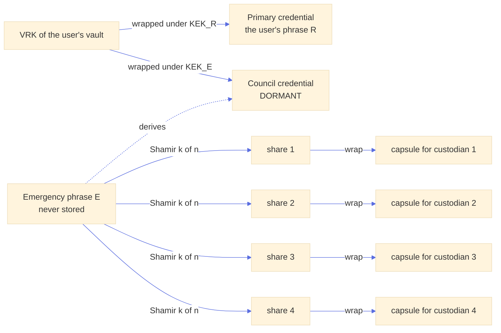
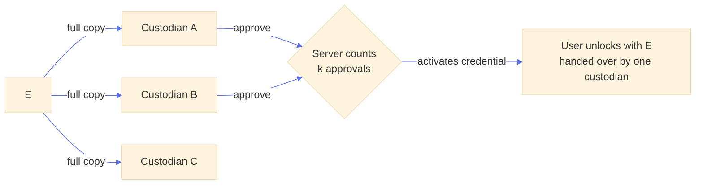
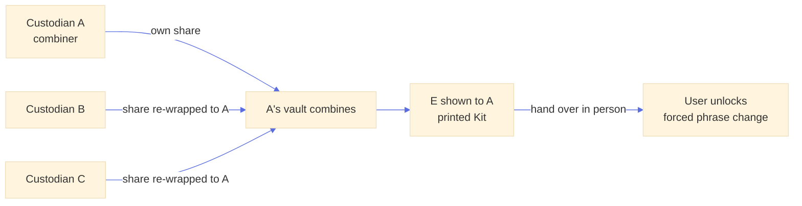
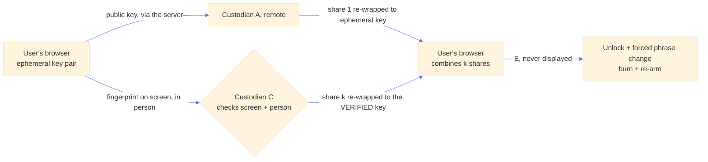
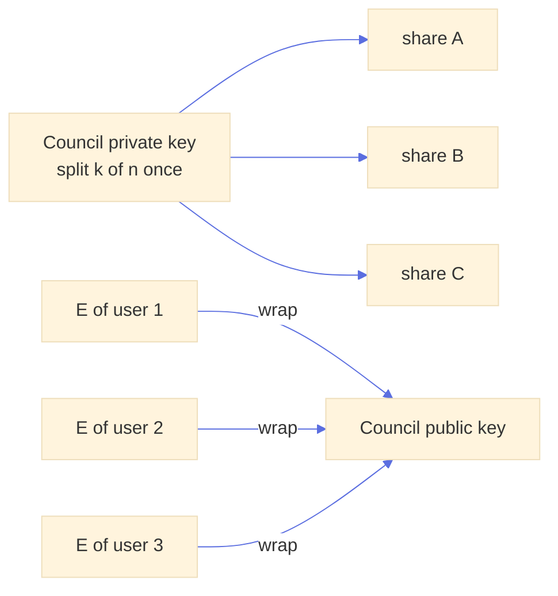
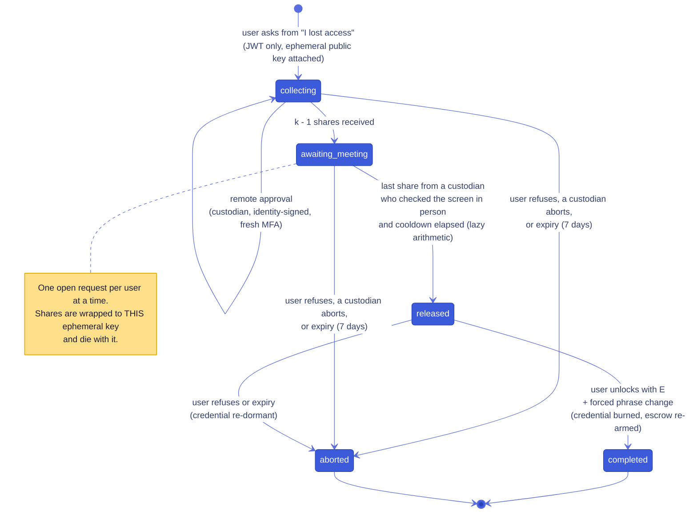
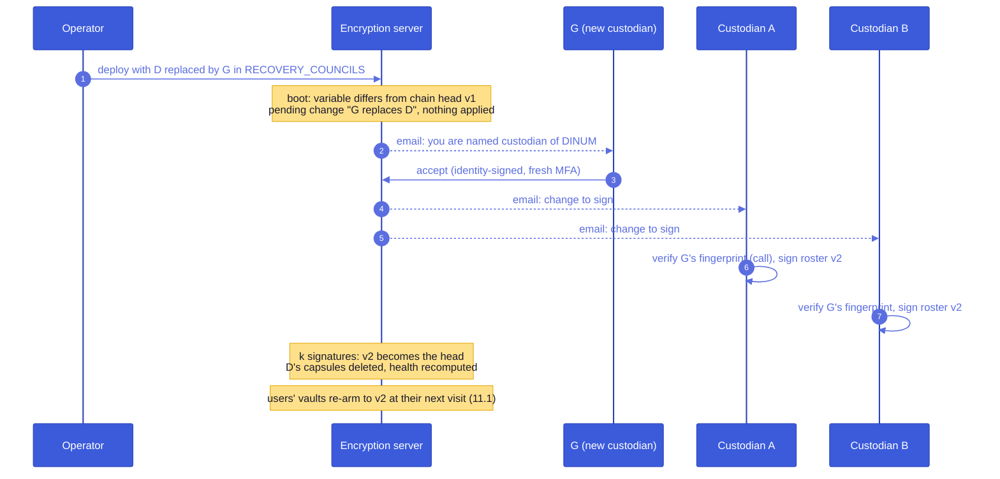

# Organization recovery by a quorum of custodians (Shamir)

Status: **exploration, nothing decided**. This document proposes a third recovery route, between the user's own Kit and trusted contacts: a designated group of people in the user's organization (security officers, DPO, IT management) who can, **together and immediately**, give a locked-out user their vault back, without any one of them being able to do it alone.

## Contents

1. [Why a third route](#why)
2. [Naming](#naming)
3. [Working decisions so far](#decisions)
4. [Configuration](#config)
5. [Common building block: split the emergency phrase](#split)
6. [Proposals P1 to P4](#proposals)
7. [Recommended flow: remote approvals, last share in person](#flow)
8. [Who is a custodian, and what each client learns](#visibility)
9. [How the user trusts the council](#roster)
10. [Governance: the configuration proposes, the custodians decide](#governance)
11. [Lifecycle](#lifecycle)
12. [Multi-factor authentication for custodians](#mfa)
13. [Threat model](#threats)
14. [Implementation notes](#impl)
15. [Open questions](#open)

<a id="why"></a>

## 1. Why a third route

Three mechanisms exist, and none covers "one person, locked out, today":

| Route | Who can act | Delay | Weakness for this case |
| --- | --- | --- | --- |
| **Recovery Kit** ([architecture.md §7.2](architecture.md#s7-2)) | The user | None | Lost with the device and the paper, which is exactly the case to cover. |
| **Trusted contact** ([architecture.md §8](architecture.md#s8)) | One chosen colleague | 1 to 90 days, by design | The colleague can leave the organization, lose their own keys, or be unreachable. The wait is the whole protection, so it cannot be shortened, and a week without one's documents is not acceptable for some roles. |
| **Maintenance escrow** ([architecture.md Appendix E](architecture.md#appendix-e)) | An organization's custodians, with its offline maintenance phrase | None | Built for a **massive** loss: a technical failure on our side (a broken encryption in a product, a support rollback), where many users must be recovered at once. It is temporary by design, and it opens **resource keys** in batch with an offline tool, never a vault. It cannot restore a person's identity, contacts or ability to keep working; using it for one person means taking out the phrase that opens the whole organization's content. |

The two are complementary rather than competing: the maintenance escrow answers "we broke something for everyone", the council answers "this person is locked out". Appendix E already points to a recovery council for the single-user case. They share their configuration shape and its code ([§4.1](#config-shared)), and probably their people ([question 8](#open)).

The new route keeps the structure of trusted contacts (a dormant second credential of the same vault, [architecture.md §8.1](architecture.md#s8-1)) and changes two things: the escrow is **split** between several people instead of given to one, and the protection is **human verification by a quorum** instead of a wait.

[architecture.md §8](architecture.md#s8) lists M-of-N recovery under "Alternatives set aside" for trusted contacts, on the ground that one well-chosen contact behind a delay is enough, and notes that shares could be added later. This document is that later case: the motivation (a contact who leaves, a delay that is not acceptable) is precisely what the set-aside reasoning did not cover.

<a id="naming"></a>

## 2. Naming

The role needs a name that says "mandated by the organization", "can only act together", and not "administrator" (they administer nothing and see nothing).

| English | French | Comment |
| --- | --- | --- |
| **Recovery custodians** | **Dépositaires de recouvrement** | Recommended. A custodian holds something in trust for someone else, which is literally what a share is. "Dépositaire" has the same legal meaning in French. |
| Recovery council / quorum | Collège de recouvrement | Recommended for the **group**: "le collège de recouvrement de la DINUM, 2 dépositaires sur 4". "Collège" already means a body that decides together in French administration. |
| Recovery officers | Délégués au recouvrement | Sounds like a job title, which is fine for a RSSI but suggests individual power. |
| Key recovery agents | Agents de recouvrement de clés | The PKI term (Windows AD CS "KRA"). Precise, but evokes a single agent with a master key. |
| Mandated recoverers | Mandataires de recouvrement | Close to "personnes mandatées", a bit heavy. |

The rest of this document uses **council** for the group, **custodian** for a member, **threshold** (`k`) for the number of shares required, `n` for the number of custodians, **margin** for `n - k`, and **share** for a custodian's piece.

<a id="decisions"></a>

## 3. Working decisions so far

Not final, but the discussion converged on these, and the rest of the document builds on them:

1. **Split a per-user emergency phrase `E`**, never the VRK and never a council-wide key ([§5](#split), [P4](#p4)).
2. **Shares meet only in the locked-out user's browser** ([P3](#p3)); no custodian ever sees `E`, and it is never displayed.
3. **The user asks; custodians approve remotely; the last share is handed over in person** after the custodian checks the user's screen ([§7](#flow)). A stolen login collects at most `k - 1` shares, which are worth nothing.
4. **The user is told little**: "request in progress", then "go and see one of these people". No count, no real-time feed.
5. **Custodians are configured as `{ userId, email }`** and must **accept** the role before they count ([§4](#config)).
6. **The configuration proposes, the custodians decide**: the authority on membership is a roster chain signed by `k` custodians; nothing destructive happens from a configuration change alone ([§10](#governance)).
7. **Membership changes never reconstruct `E`**: users' vaults re-arm silently on their next visit, and custodians can reshare for the users who do not come back ([§11](#lifecycle)).
8. **Custodians must use MFA**, checked from the token claims, with a fresh authentication before every custodian action ([§12](#mfa)).
9. **The frontend never receives the list of custodians' user ids**: a user learns "you are a custodian of these councils", nothing about the others unless they are one ([§8](#visibility)).
10. **The configuration mirrors `MAINTENANCE_ESCROW_KEYS`** (proposed): a list of entries, each with the email `domains` it covers and what is assigned to them, matched by the same code ([§4.1](#config-shared)).

<a id="config"></a>

## 4. Configuration

Councils are proposed by deployment configuration, the way maintenance keys are: an environment variable holding a JSON list, validated by Zod in `src/server/env-schema.ts`, with the **same shape** as `MAINTENANCE_ESCROW_KEYS` (a list of entries, each covering email `domains`, with what is assigned to those users behind).

```json
MAINTENANCE_ESCROW_KEYS='[
  { "domains": ["numerique.gouv.fr"], "publicKey": "AUJC…" }
]'

RECOVERY_COUNCILS='[
  {
    "id": "dinum",
    "label": "Équipe sécurité DINUM",
    "domains": ["numerique.gouv.fr"],
    "custodians": [
      { "userId": "0b7e5f0c-6a0e-4a0f-9d5e-2f1c8e3a9b11", "email": "rssi@numerique.gouv.fr" },
      { "userId": "6f2d4c1a-3b5e-4e7f-8a9b-0c1d2e3f4a5b", "email": "dpo@numerique.gouv.fr" },
      { "userId": "9a8b7c6d-5e4f-4a3b-2c1d-0e9f8a7b6c5d", "email": "dsi@numerique.gouv.fr" },
      { "userId": "1e2f3a4b-5c6d-4e7f-8a9b-0c1d2e3f4a5b", "email": "sg@numerique.gouv.fr" }
    ],
    "threshold": 2,
    "cooldownMinutes": 0,
    "requestTtlDays": 7,
    "requiredAcr": "eidas2",
    "requiredAmr": ["mfa"]
  }
]'
```

- **An array of objects, not a map keyed by pattern**, as for maintenance keys. A council usually covers several domains (a ministry and its directorates), and it needs a stable `id`: escrows reference it, and the roster chain of [§9](#roster) is keyed by it.
- **Domains match exactly as for maintenance keys** ([architecture.md Appendix E](architecture.md#appendix-e)): a listed domain covers itself and its subdomains on a label boundary (`monequipe.numerique.gouv.fr` belongs to `numerique.gouv.fr`, `fauxnumerique.gouv.fr` does not), the longest listed domain wins, `*` covers every other email, and an email no entry covers gets no council proposed. A domain listed twice is refused at boot. Only a verified email is matched (the same rule as `OIDC_ACCEPT_UNVERIFIED_EMAIL`). Most deployments serve one organization and will write `["*"]`, as they do for maintenance keys. The match only decides **what is proposed** at onboarding: the escrow then records the council id and roster version, so a later email change does not move it.

<a id="config-shared"></a>

### 4.1 Shared with the maintenance escrow

Both variables answer the same question, "which group of the organization does this email belong to, and what is attached to that group", so they should share one implementation rather than two copies drifting apart:

```
src/server/email-domain-groups.ts          (new, extracted from maintenance-escrow.ts)
├── emailDomainSchema                      lowercase punycode labels, or "*"
├── refineDomainGroups(entries, ctx)       a domain listed twice → boot error
├── domainGroupForEmail(entries, email)    longest label-boundary match, else "*", else null
└── jsonEnv(schema, hint)                  the JSON.parse preprocess of env-schema.ts

maintenance-escrow.ts   entries: { domains, publicKey }               → a public key
recovery-councils.ts    entries: { id, label, domains, custodians, … } → a council
```

`maintenanceEscrowKeyForEmail` becomes `domainGroupForEmail(entries, email)?.publicKey`, with its tests moved to the shared module, so the matching rules of [Appendix E](architecture.md#appendix-e) are written and tested once. Other parts can follow the same pattern:

- **Boot log.** The server already logs each maintenance key's fingerprint with its domains; it logs each council's fingerprint ([§9](#roster)) with its domains the same way, so an organization checks both in one place.
- **Operator documentation.** One README section on "email domain groups", with each variable describing only what it attaches.

**Two variables, not one.** A single `ORGANIZATIONS` variable holding `{ domains, maintenanceKey, council }` reads well but couples two lifecycles: the maintenance escrow is temporary and meant to be turned off ([Appendix E](architecture.md#appendix-e)), while a council is permanent and its membership evolves under signatures ([§10](#governance)); the groupings may also differ (one key per ministry, one council per directorate). Two variables with the same shape and the same code give the consistency without the coupling. The endpoints stay separate too: `/api/maintenance-escrow/assignment` answers a key fingerprint for **any owner** the vault names, unauthenticated, on every encryption, while the council lookup of [§8](#visibility) answers the **signed-in user's own** council at onboarding, with its roster and keys.

**Identifying custodians: `{ userId, email }`.** The candidates compare as follows:

| Identifier | Stable? | Problem |
| --- | --- | --- |
| email | no | reassignable (namesake, departure then hiring), changes (marriage, domain merger) |
| issuer + sub | no | changes when the identity provider is migrated ([architecture.md Appendix A](architecture.md)) |
| **internal userId** | **yes, by design** | opaque in a configuration file, so a copy-paste mistake is easy |

The internal user id ([architecture.md §2.3](architecture.md#s2-3)) is what survives an email change, a new `sub` and a provider migration; even a user who starts over keeps it (only their vault and identity change). It is therefore **authoritative**. The email is a **readability guard**: if the current email of that user id no longer matches the configured one, the council is logged as misconfigured and the change it proposes is not offered for signature, so a wrong id shows up as an error instead of silently splitting secrets to a stranger. An operator command, `npm run council -- resolve rssi@numerique.gouv.fr`, prints the id to copy. The last and strongest guard is **acceptance**: a configured person counts only after accepting the role in their interface ([§10](#governance)), so the wrong person refuses, or at least sees the mistake.

**Threshold, as an absolute number.** Validated at boot: `2 <= threshold` and `threshold + 1 <= custodians.length`, otherwise the server refuses to start. A threshold of 1 is a trusted contact without the wait, weaker than what this feature claims. A percentage reads well but rounds silently (`50%` of 3 is 1 or 2?) and changes meaning when the roster grows, while every existing escrow keeps the threshold it was split with. The `+ 1` is the minimum margin: one departure never blocks recoveries. A margin of 2 or more is recommended and the boot logs a warning below it.

**Other fields.** `cooldownMinutes` (default 0): minimum time between the start of a recovery and its release, for organizations that want a window in which the user can refuse from their mailbox. `requestTtlDays` (default 7): how long a user's recovery request stays open ([§14](#impl)). `requiredAcr` / `requiredAmr`: the MFA policy for this council's custodians ([§12](#mfa)).

<a id="split"></a>

## 5. Common building block: split the emergency phrase, not the vault

Every Shamir proposal below shares the same escrow, an extension of [architecture.md §8.1](architecture.md#s8-1):

1. The user's open vault generates a fresh emergency phrase `E` (24 words) and derives a **dormant credential** from it, exactly like a trusted-contact escrow: same VRK, its own KEK and auth key.
2. The 32 bytes of entropy of `E` are split into `n` shares with threshold `k` (Shamir over GF(2^8), byte by byte).
3. Share `i` is wrapped to custodian `i`'s active X-Wing key: one **capsule** per custodian.
4. `E` and the shares are discarded. The escrow is signed by the user's identity key over the council id, the roster version and hash, `k`, SHA-256 of the credential's auth public key, and SHA-256 of each capsule **and of each share** (so the combiner can reject a bad share before combining, see [§14](#impl)).



Why split `E` and not something else:

- **Not the VRK.** The VRK is constant for the life of the vault (there is no VRK rotation, [architecture.md §4.4](architecture.md#s4-4)): once reconstructed somewhere, it stays a valid key to every item forever, and nothing can revoke it short of re-encrypting the whole vault. `E` is only a way in: it is useless while its credential is dormant (the server refuses the unlock proof outside an approved session, and serves the vault only to the user's own login), and it is revoked for good by deleting its credential, which the forced phrase change does right after recovery. It also reuses the ordinary cold unlock ([architecture.md §7.2](architecture.md#s7-2)), so recovery adds no new way to open a vault. Against a database leak, `E` is as strong as the VRK (it unwraps the credential's wrapped VRK), so the gain is revocability and server gating, not secrecy.
- **Not the user's phrase `R`.** It dies at every phrase change, and the user would have to give it away.
- **One fresh secret per user**, so a reconstruction exposes one person, never the council's power over everyone (that is what [P4](#p4) gets wrong).

**Why not split the 24 words themselves** (each custodian gets 6 words): that is not Shamir. It needs **all** pieces (no threshold, one departure blocks everything), each piece reveals part of the secret (three colluders holding 18 words have far less left to guess), and the user must know which words go where. A real Shamir share is as large as the secret: 32 bytes plus an index, about 25 words each. SLIP-39 does exactly that, and a "dictated shares" variant is possible ([P3-bis](#p3bis)).

The server side reuses `VaultCredential` with a new type `council`, a `council_escrows` row per (user, council) and one `council_capsules` row per custodian slot. Nothing in the vault format changes.

<a id="proposals"></a>

## 6. Proposals

The proposals differ in **where the shares meet**, and therefore who ever sees `E`. Shamir needs `k` shares **in one place** to rebuild the secret; there is no way to "reconcile at everybody's" without everybody seeing `E` (P2-bis) or without multi-party computation, which is out of proportion here. The best single place is the user's own browser.

<a id="p1"></a>

### P1. Approval quorum, no Shamir (baseline)

Each custodian holds a **full** capsule of `E`, like `n` trusted contacts without a wait. The server releases the credential once `k` custodians have approved with their identity signature.



- **For**: trivial, no new cryptography.
- **Against**: the quorum is **server policy only**. Any single custodian can already decrypt `E` from their capsule; one custodian plus a compromised server is enough. "k of n" is a promise, not a property.
- **Verdict**: comparison only. If we accept that, a trusted contact with a short wait is equivalent.

<a id="p2"></a>

### P2. Shamir, combined by one custodian

Each approving custodian unwraps **their** share and re-wraps it to **one custodian's** encryption key (the initiator, or the last approver). That custodian's vault combines the shares, checks the result against the signed commitment, and shows `E` as a Kit, a "temporary recovery key" handed over to the user in person. Variant **P2-bis**: every approver re-wraps to every other participant, so all of them see `E`.



- **For**: the user needs no browser session during the approvals; the Kit is an object users already know.
- **Against**: the combiner (or, in P2-bis, every approver) **learns `E`**. Until the user's forced phrase change burns it, the combiner plus the user's login opens the vault, and in an organization the custodians often control the identity provider. P2-bis multiplies the holders of a live credential for no gain.
- **Verdict**: fallback for a user who cannot sit at a computer, not the default.

<a id="p3"></a>

### P3. Shamir, combined in the user's browser (recommended)

The shares meet **only in the locked-out user's own browser**. At the start of the request, the user's vault generates an **ephemeral X-Wing key pair**; custodians re-wrap their share to it. Once `k` shares arrive, the user's browser combines them, unlocks with `E`, and is forced into a phrase change that burns the council credential and re-arms a fresh escrow. **No custodian ever sees `E`, and nobody needs to see it at all.**

The ephemeral public key reaches custodians **through the server**, so a custodian cannot tell by themselves whether it was generated by the real user's browser, by someone using a stolen login, or substituted by a compromised server. The protection is a human check: a custodian compares the key's fingerprint (40 digits or a QR) with the screen of a person they recognize, the device-pairing pattern of [architecture.md §7.5](architecture.md#s7-5). [§7](#flow) makes that check bear on the **last** share only, which keeps the guarantee cryptographic while asking one meeting instead of `k`.



**Why the quorum can replace the wait.** The wait of trusted contacts exists because a stolen login could otherwise start a recovery and the only defence is the real user noticing. Here a stolen login can start a request and even collect remote approvals, but it gets the last share only if a custodian, facing the person, recognizes them and sees that key on their screen. That is a stronger barrier than a wait, and it is immediate. Organizations that want a window anyway set `cooldownMinutes`.

<a id="p3bis"></a>

### P3-bis. Dictated shares (SLIP-39 style)

Same principle without an ephemeral key or a server relay: each custodian, in person or on a video call, reads **their share** as a ~25-word mnemonic (with a checksum, as in SLIP-39), and the user types it; the user's browser combines. The human check is implicit (you dictate to the person you recognize). Against: `k × 25` words to type, typing errors, and shares spoken in the clear over a call (acceptable, since a share alone is worthless). Kept as an offline fallback (custodian's interface down, network trouble), not the default.

<a id="p4"></a>

### P4. One council key pair, split once (rejected)

The council is a principal with one X-Wing key pair whose private key is Shamir-split between custodians once; each user wraps `E` to the **council public key** (one capsule, nothing to re-arm when a custodian leaves). This is 1Password's Recovery group, or the maintenance phrase split between custodians as [architecture.md Appendix E](architecture.md#appendix-e) recommends.



- **For**: membership changes are a council-only operation, invisible to users; one capsule per user.
- **Against**: recovering **one** user requires reconstructing the **council private key** somewhere, and whoever holds it at that moment can open the `E` of **every** user. One recovery exposes the whole organization. Avoiding the reconstruction needs threshold decryption, which X-Wing (ML-KEM) does not offer in any usable library today.
- **Verdict**: rejected. It is the maintenance escrow's model, right for a batch tool kept in a safe, wrong for a routine per-person operation.

### Comparison

| | P1 approvals | P2 one combines | **P3 user combines** | P3-bis dictated | P4 council key |
| --- | --- | --- | --- | --- | --- |
| Shares meet in | (no shares) | a custodian's browser | **user's browser** | user's browser | wherever the council key is rebuilt |
| Who sees `E` | every custodian can | combiner (all, in P2-bis) | **nobody** | nobody | the holder sees every user's |
| One custodian + server can recover | yes | no | no | no | no |
| Stolen login alone gets | nothing (server policy) | nothing | **at most `k - 1` shares** | nothing | nothing |
| Immediate | yes | yes, plus a handover | **yes, one meeting** | yes, `k` dictations | yes |
| Custodian departure | delete one capsule | delete one capsule | delete one capsule | delete one capsule | reshare the council key |

<a id="flow"></a>

## 7. Recommended flow: remote approvals, last share in person

The user starts; custodians are notified by email and approve **remotely**; the user only sees "request in progress", then "go and see one of these people"; the person they meet checks their screen and contributes **the last share**.

What the meeting is **not**: the custodian does not hand over a temporary key (that would be P2, someone saw `E`). They **confirm** the user's screen and give the last share to it. The user's experience is the same sentence, "go and see one of these people", with a stronger property: until the meeting, whoever holds the request has `k - 1` shares, which mathematically reveal nothing about `E`.

### 7.1 State machine



A custodian can also **open** a request on behalf of a user who called them (identity-signed); the user's interface then shows "a recovery was started for you" and attaches its ephemeral key, and the flow continues at `collecting`.

### 7.2 What the user sees

1. **"I lost access"** ([architecture.md §7.8](architecture.md#s7-8)) offers "ask your organization's recovery council" when an escrow exists. The vault generates the ephemeral key pair (private key in the vault's IndexedDB, never in the interface) and opens the request.
2. **"Request in progress."** No count, no names of who approved. An email confirms the request to the user's address (if it was not them, the email has a link to refuse, which needs only a login, fail-safe as in [architecture.md §8.2](architecture.md#s8-2)).
3. **"Go and see one of these people: C, D."** Shown at `awaiting_meeting`, listing the custodians who have **not** contributed yet (only they can give the last share). It reveals by complement who approved, which is acceptable. The screen also shows the ephemeral key's QR and 40 digits.
4. **"Unlocked."** The screen polls every few seconds while it is on the meeting step; once released, the browser fetches the wrapped shares, combines, checks, unlocks, and goes straight to "choose a new phrase, print your new Kit".

**No real-time push is needed for the user.** A check when the page opens or regains focus is enough, plus short polling on the meeting screen only. (Note for any later push: the native `EventSource` API cannot send an `Authorization` header and the interface authenticates with a bearer token, so a stream would use `fetch()` with a streamed body; and the in-memory listener registry of `src/server/vault-notify.ts` spans one process, so several instances would need PostgreSQL `LISTEN/NOTIFY`.)

**If the user's own screen shows nothing at the meeting** (the open request was not started from this browser, for example by someone with a stolen login), the interface says so explicitly and offers to refuse it, which aborts the request and discards its shares. The custodian, seeing a key that matches nothing on the user's screen, does not contribute.

### 7.3 What custodians see and do

Custodians are notified by **email**, which is how they learn about a request; their interface lists open requests across all their councils ([§8](#visibility)). A remote approval means "this request is legitimate as far as I know" (the user called, a ticket exists): it does **not** require seeing the user, because a single share is worthless. The in-person step is the one that binds.

### 7.4 Sequence


**Contribution signature.** Each contribution is signed by the custodian's identity key over the request id, the user id, SHA-256 of the ephemeral public key, SHA-256 of the wrapped share and the `inPerson` flag (context `lasuite-encryption/council-share/v1`). After recovery, the user's vault shows "recovered on 8 October 2026 with the approval of A and, in person, C" and verifies the signatures, so a server that released without real approvals is caught afterwards.

**What the user's login alone can do**: open a request, fetch wrapped shares, refuse. It never yields more than `k - 1` shares without a person in front of a custodian. **What a custodian alone can do**: open, contribute, abort. A contribution is useless without `k - 1` others and the ephemeral private key.

<a id="visibility"></a>

## 8. Who is a custodian, and what each client learns

A user is a custodian of a council when they are in the **head of its roster chain** (stored in the database, [§9](#roster)), and is **invited** to become one when the configuration names them in a change not yet signed ([§10](#governance)). The configuration is parsed server-side only and never sent to a browser.

The frontend never receives the list of custodians' user ids. Each client gets exactly what its role needs:

| Who | Endpoint | Receives | Never receives |
| --- | --- | --- | --- |
| Any user | `GET /api/councils/mine` | the councils where **they** are custodian or invited: id, label, role (`custodian` / `invited`), `k`, `n` | anything about councils they are not part of |
| A custodian, for their councils | same response, custodian part | the other custodians (name, email, fingerprint, status: active, reset, invited), the council's health ([§11.4](#margin)), the pending change to sign, the open requests | |
| A user being onboarded or re-arming | `GET /api/councils/for-me` | the council matching their email: id, label, `k`, roster version and fingerprint, and for each **slot** the custodian's identity and encryption public keys with their binding signatures (what the vault needs to wrap the shares), plus the roster chain signatures | user ids, names, emails of custodians |
| A user with an open request | `GET /council-recovery/requests/mine` | status; at `awaiting_meeting`, the names of the custodians who have not contributed yet | the count of approvals before that point, who approved |

An empty `/api/councils/mine` means "not a custodian", and the interface hides the whole custodian section. The public keys in `for-me` are keyed by slot, not by user id; reversing them would need a directory lookup per user id, which nobody can enumerate.

**Custodian of several councils.** Allowed and expected (a ministry's RSSI on the councils of several directorates). The interface keeps it simple:

- **One inbox** of open requests across councils, each labelled with its council, sorted by age.
- **One card per council** in the custodian settings: members, health, pending change to sign.
- Every action names the council it acts on, and the MFA step-up ([§12](#mfa)) applies per action, so acting on two councils in a row does not reuse a stale authentication.
- The server stores one capsule per (user escrow, slot), so being in several councils changes nothing cryptographically; a person in two councils simply holds shares of different users' escrows.

<a id="roster"></a>

## 9. How the user trusts the council

**Why it matters.** The user's browser wraps each share to the custodians' public keys, and those keys come from the server. A compromised server, or anyone able to edit the database, could slip in their own keys, receive the shares and rebuild `E`. That breaks [architecture.md §3.1](architecture.md#s3-1) (a compromised server cannot get access). The critical moments are when the user accepts the council at onboarding and every silent re-arm afterwards. Accepting the list without any check would be trust on first use, which the design rules out elsewhere ([architecture.md §5.4](architecture.md#s5-4)).

**One fingerprint for the whole council.** The roster is `{councilId, version, k, custodian identity public keys sorted}`; its fingerprint is `SHA-256` of its framed encoding, truncated to 128 bits and shown as 40 digits, the usual format ([architecture.md §4.3](architecture.md#s4-3)). Truncating a hash loses no useful entropy: it is exactly how individual fingerprints are made. It must be a **hash, not a sum**: a sum of keys is malleable (an attacker adjusts one key so the total stays the same), a hash is not. The organization publishes this fingerprint outside the service (intranet page, onboarding email from the RSSI, welcome pack). The user compares it once when accepting the council, and the vault pins the council in its TOFU registry as `trusted`.

**A roster chain signed by custodians.** Every later roster version (a custodian joins, leaves, resets, `k` changes) must be signed by `k` custodians of the **previous** version (context `lasuite-encryption/council-roster/v1`). The user's vault walks the chain from the pinned version, so membership changes need no new check from users, and the server alone cannot forge a version. This is Keybase's team sigchain reduced to one operation.

```mermaid
%%{init: {'theme':'base','look':'classic','themeVariables':{'lineColor':'#5b6ee0','edgeLabelBackground':'#ffffff','clusterBkg':'#f5f7ff','clusterBorder':'#9aa7e8','titleColor':'#1a1a2e'},'themeCSS':'.edgeLabel p{background-color:#ffffff;color:#444;font-style:italic;border:1px solid #b5b5b5;padding:2px 8px;border-radius:10px;margin:0;} .edgeLabel .labelBkg{background:transparent;}'}}%%
flowchart LR
  P[Fingerprint published<br/>by the organization] -.->|compared once by the user| V1
  V1[Roster v1<br/>A B C D, k=2] -->|signed by k of v1| V2[Roster v2<br/>A B C G, k=2<br/>G replaces D]
  V2 -->|signed by k of v2| V3[Roster v3<br/>A B C G'<br/>G reset, new key]
  V3 -.->|vault walks the chain| U[User's vault re-arms<br/>to v3 silently]
```



**Transparency log (later).** A public append-only log of roster versions does not prevent a substitution but detects it, and here the monitors are already known: each custodian's interface checks that every published roster version of their councils lists **their** real key and no unexpected one. Its main value is against the stealthiest attack, a server showing a forged roster to **one** targeted user only (split view). With such a log and custodian monitoring, the user-side fingerprint comparison could become optional.

**An organization signing key** that certifies the roster was considered: users would then have to trust that key, which moves the same problem one step up.

**Recommendation for a first version**: the council fingerprint compared at acceptance, plus the chain. Without the comparison, the documentation must say plainly that the council is trusted on first use.

<a id="governance"></a>

## 10. Governance: the configuration proposes, the custodians decide

The authority on membership is the **roster chain** in the database. The environment variable is only a **proposal**. This gives the rules:

- **Nothing destructive without `k` signatures.** If the variable is empty, invalid or missing, the server deletes nothing and stops no recovery. It logs an error, and custodians see "the configuration does not match the registered council; no membership change possible". Recoveries keep using the head of the chain. A missing variable never dissolves a council.
- **A difference between the variable and the chain head is a pending change.** Custodians see "add G, remove D, proposed by the configuration" in their interface and sign it, `k` of them, each after a fresh MFA login. A new custodian must appear in the variable first, then the others "promote" them by signing.
- **The newcomer accepts too.** Their interface shows "you are named custodian of council X"; they accept (or refuse, which surfaces a configuration mistake). The signers check the newcomer's identity fingerprint like any out-of-band verification; they are colleagues, a call is enough.
- **Replacement is one step.** A single edit of the variable replaces D by G, and a single roster version says "G replaces D". No 6, then 7, then 6 again. The `k` signers can be any custodians of the previous version, D included if still around.
- **Bootstrap (not decided).** The very first roster version cannot be signed by a previous one. Options: signed by **all** its custodians (strict, but one absent person delays the council's creation), or active once `k + 1` have accepted and signed, the others joining later as ordinary promotions. Either way its fingerprint is what the organization publishes ([question 10](#open)).



<a id="lifecycle"></a>

## 11. Lifecycle

**Changing membership never reconstructs a secret.** There is no council-wide key; each user has their own `E`. Two mechanisms move escrows to a new roster, and neither rebuilds `E` anywhere.

<a id="rearm"></a>

### 11.1 Silent re-arm by the user's vault (default)

Re-arming needs an **open vault**, not the user's phrase, and every enrolled device has one. At the next page load in Docs or Drive, the vault sees that its escrow targets an older roster version, walks the chain ([§9](#roster)), draws a fresh `E'`, splits it over the new roster, and replaces the old credential and capsules in one write (as trusted contacts are re-armed, [architecture.md §8.6](architecture.md#s8-6)). No screen, no click: ten thousand users are not disturbed, their escrow updates on their next visit.

<a id="reshare"></a>

### 11.2 Resharing by custodians (for users who do not come back)

Users who never return keep an escrow on an old roster version. It stays recoverable as long as `k` of that version's custodians remain live. To move them anyway, custodians can **reshare** without the user and without rebuilding `E` (Desmedt-Jajodia redistribution):

1. `k` custodians of the old version each take their share `s_i`, multiply it by its Lagrange coefficient, split the result into new Shamir shares for the new roster, and wrap one to each new custodian.
2. Each new custodian adds the sub-shares they received: the sum is a valid share **of the same `E`** on a new polynomial.
3. Old capsules are deleted.

Nobody ever sees `E`. It runs as a batch in the custodian's vault: for 10,000 users, a few X-Wing operations per user per participant, on the order of a minute (to measure).

**Caveat.** A dishonest or buggy old custodian sending wrong sub-shares corrupts **every** new share of that escrow, discovered only at recovery (the final check against the user-signed commitment fails). Two answers: **simple**, keep the previous generation (minus the departed custodian's capsules) until the user's vault re-arms; **robust**, do Shamir over a prime field with Feldman commitments, which makes every sub-share verifiable. The second is more work and not needed for a first version.

### 11.3 Events

- **A custodian leaves.** Roster change ([§10](#governance)). The server deletes their capsules at once, so they can no longer obtain a share. Escrows stay recoverable through the margin, and [§11.1](#rearm) moves them to the new roster. A departed custodian who saved an unwrapped share earlier still needs `k - 1` others from the **same** split, which re-arming invalidates.
- **A custodian resets their vault** (lost everything, starts over, [architecture.md §7.8](architecture.md#s7-8)). Same user id, **new identity**: their capsules target keys that no longer exist, so they are **lost to the council while still in the configuration**. The server detects a new identity without continuity link for a custodian's user id and notifies the other custodians: "B reset their vault, their shares are lost, margin now 1". Re-admission needs no configuration change, since it is the same person: a new roster version "new key for B", signed by `k` others after checking B's new fingerprint. Then [§11.1](#rearm) or [§11.2](#reshare) give B fresh shares.
- **A custodian's identity changes legitimately** (continuity chain, [architecture.md §5.4](architecture.md#s5-4)): the chain walk keeps their slot; nothing to do.
- **A custodian's encryption key rotates**: their old key stays in their vault, so their capsules still open; the next re-arm targets the new key.
- **A custodian joins**: roster change; shares arrive with the re-arms.
- **The user changes phrase, or recovers through a trusted contact.** The burn + re-arm write ([architecture.md §8.5](architecture.md#s8-5)) re-arms the council escrow too, so no revealed `E` survives anywhere.
- **The user starts over.** Like trusted contacts, the escrow stays on the dormant vault (anti-lockout against a stolen session); the new vault gets a new escrow at onboarding.
- **The user leaves the council's domain.** Nothing automatic: the escrow names its council. The settings show it and offer to switch when another council matches.

<a id="margin"></a>

### 11.4 Margin and health

- **Boot rule**: `n >= k + 1` mandatory, `n >= k + 2` recommended. With 2 of 4, two departures are absorbed.
- **Health, visible to custodians** for each roster version still in use: how many escrows, and how many of their slots still target live keys. An alert when a version's margin reaches 0: "one more departure would make the recovery of X users impossible". The fix is a replacement, then the re-arms.
- **An absence of unknown length** (long illness, extended leave) is handled the same way: replace ahead of time rather than wait.
- **Two departures at once** with a margin of 1: the users who re-armed since the first departure are safe; the others are recoverable only by a reshare done **before** the second departure, which is exactly what the health alert is for.

<a id="mfa"></a>

## 12. Multi-factor authentication for custodians

Custodian actions (contribute, abort, accept the role, sign a roster version) require MFA on the OIDC login:

- **Checked by the server** from the token claims: `amr` (for example `mfa`, `otp`, `hwk`) or a minimum `acr`, configured per council (`requiredAmr`, `requiredAcr`).
- **Fresh authentication**: before each of these actions the interface asks for a new login with `acr_values` and `max_age=300`, and the server checks `auth_time`, so a session from the day before is not enough.
- **Per identity provider**: Keycloak supports step-up natively. For ProConnect, which `acr` and `amr` values are actually exposed must be checked before relying on them.
- **When the provider exposes nothing**, the server cannot be sure. The council then runs in a degraded mode, with a warning at boot and in the custodians' interface, rather than pretending.
- **Honest limit**: the claim is issued by the identity provider, often run by the same RSSI. MFA protects against a stolen password, not against collusion. Custodian actions are also signed by the identity key of an open vault ([architecture.md §6.4](architecture.md#s6-4)), which already adds a device factor; MFA mostly hardens the login part.

The locked-out **user** is not required to use MFA to open a request: the request yields nothing without a meeting, and refusing must stay possible from a bare login.

<a id="threats"></a>

## 13. Threat model

| Attacker | Outcome with the recommended flow |
| --- | --- |
| Stolen user login | Can open a request and collect up to `k - 1` remote approvals, which reveal nothing. Gets the last share only if a custodian, facing the person, sees the attacker's key on the real user's screen, which cannot happen. The user is emailed at once and can refuse. |
| Compromised encryption server | Cannot combine shares (each is wrapped to a custodian, then to the ephemeral key). Can substitute the ephemeral key, but the in-person custodian compares its fingerprint with the user's screen. Can substitute the roster only before the user pinned it ([§9](#roster)); after that, a forged version fails the chain. Can release the credential without real approvals but still needs `E`, which it never sees; the user's vault detects missing contribution signatures afterwards. |
| Broken or tampered configuration | Proposes a change, applies nothing: membership changes need `k` custodian signatures ([§10](#governance)). |
| One custodian | A single share is information-theoretically worthless. |
| `k` colluding custodians | Reconstruct `E` (each unwraps their own share). Still need the user's login to fetch the vault ([architecture.md §8.1](architecture.md#s8-1)). **If the same people control the identity provider** (an RSSI often does), they can mint that login: `k` colluding custodians with control of the identity provider open the vault. This is inherent to any organizational recovery and must be stated plainly to deploying organizations: pick custodians from separate functions (security, DPO, management) and keep `k >= 2`. |
| Custodian submits a corrupted share | The combiner checks each share against the hash in the user-signed escrow before combining, names the faulty contribution, and the request waits for another custodian. |
| Organization wants to read a user's documents without them | Out of scope, as for trusted contacts: the recommended flow requires the user's browser. P2 would allow it with control of the identity provider; the maintenance escrow is the documented tool for that case, with its own governance. |

<a id="impl"></a>

## 14. Implementation notes

- **Configuration code shared with the maintenance escrow** ([§4.1](#config-shared)): extract the domain schema, duplicate check, matching and JSON parsing from `src/server/maintenance-escrow.ts` first, as a refactor on its own with the existing tests, then build `RECOVERY_COUNCILS` on it.
- **Shamir library.** Shamir over GF(2^8) is about 100 lines, but subtle (constant-time field arithmetic, unique non-zero x-coordinates). The candidate is [`shamir-secret-sharing`](https://github.com/privy-io/shamir-secret-sharing) by Privy: TypeScript, no dependency, audited by Cure53 and Zellic, Web Crypto randomness. Pinned like every dependency, vault bundle only. Feldman verifiable secret sharing is unnecessary for the initial split (the signed per-share hashes say which share is bad, and the dealer is the user's own vault); it becomes useful only for resharing ([§11.2](#reshare)).
- **Share format.** `x (1 byte) || y (32 bytes)`, wrapped with the existing `wrap(K, pk)` ([architecture.md §4.3](architecture.md#s4-3)). The commitment is `SHA-256("lasuite-encryption/council-share-hash/v1" || councilId || share)`, domain-separated, harmless to publish since each share is 256 bits of uniform randomness.
- **New signed messages**, framed like the others: `council-escrow/v1` (user identity key: user id, council id, roster version and hash, `k`, SHA-256 of the credential auth key, capsule and share hashes in slot order), `council-share/v1` (custodian identity key, [§7.4](#flow)), `council-roster/v1` (custodians' identity keys, [§9](#roster)).
- **Tables.** `council_rosters` (council id, version, `k`, slots with identity id, signatures), `council_escrows` (user, council, roster version, credential id, escrow signature), `council_capsules` (escrow, slot, capsule, key version), `council_requests` (user, ephemeral public key, status, timestamps), `council_contributions` (request, slot, wrapped share, in-person flag, signature).
- **Routes and tiers** ([architecture.md §6.4](architecture.md#s6-4)): contribute, abort, accept the role and sign a roster version are **identity-signed with fresh MFA**; open a request, fetch the wrapped shares and refuse are **JWT only** for the user (they have no vault left), and safe because nothing they reach releases key material without a meeting. Admitting the council credential in the unlock proof recomputes "`k` valid contributions, at least one in person, cooldown elapsed" at release time, like the lazy wait arithmetic of trusted contacts.
- **Ephemeral private key** lives in the vault's IndexedDB, never in the interface, and is deleted when the request ends. A reloaded tab keeps the request; another browser does not, which is acceptable (refuse and ask again).
- **Expiry of a user's recovery request**: 7 days by default, configurable per council (`requestTtlDays`), so holidays do not kill a request: any `k - 1` custodians can approve remotely, and the meeting needs only one of the approvers' remaining colleagues. A long-open request costs little, since `k - 1` shares open nothing without the meeting. Refused or expired requests delete their contributions. A **proposed roster version** ([§10](#governance)) has no expiry: it waits for its signatures until signed or superseded by a newer proposal.
- **Onboarding UI.** When a council matches, the trusted-contact step proposes it first: "Your organization has a recovery council (2 of 4). Compare its fingerprint with the one published by your organization." A trusted contact stays available as an addition, not a replacement.
- **Custodian UI.** One inbox across councils, one card per council ([§8](#visibility)), the QR scanner or digit entry for the meeting step.

<a id="open"></a>

## 15. Open questions

1. **Mandatory or proposed?** An organization may want every user escrowed. The server can refuse the first keyring commit without a council escrow row and check its signature and capsule count, but it cannot check that the shares are correct (they are encrypted). A dishonest client can always opt out; the question is whether honest users may skip.
2. **Is P2 needed**, for a user who cannot sit at a computer? If the user is in hospital, it is a succession case, out of scope for both this route and trusted contacts.
3. **Roster trust in the first version**: fingerprint comparison plus chain ([§9](#roster)), or the weaker "accept the displayed council" with a documented limitation?
4. **Names at onboarding**: should the user see who the custodians are when accepting the council, or only at `awaiting_meeting`? Organizations often publish the list anyway.
5. **Video call for the last share**: accepted as "in person" (recognizing a colleague on camera), or a physical meeting only?
6. **Cooldown default**: 0 (the meeting is the protection) or a short value so the email to the user always arrives before release.
7. **Resharing in the first version** ([§11.2](#reshare)), or only silent re-arm plus the health alert?
8. **Relation with the maintenance escrow**: the configuration and its code are shared ([§4.1](#config-shared)); the keys stay fully separate (one is a per-person routine, the other a sealed, temporary batch tool). The open part is the people: Appendix E recommends splitting the maintenance phrase between the security officer, the DPO and a service owner, who are likely the council's custodians. Should the maintenance tool offer to split its phrase (SLIP-39 style, offline) and document the council as its natural holders, or keep the two groups unrelated on paper?
9. **Domains optional?** Every entry lists `domains` (with `*` for "everyone"), as maintenance keys do. Another way would be a council attached to users explicitly (a list, or a group of the identity provider) instead of by email domain; not needed while organizations map to domains, and the same question would then apply to maintenance keys.
10. **First roster**: signed by all its custodians, or active from `k + 1` acceptances ([§10](#governance))?
